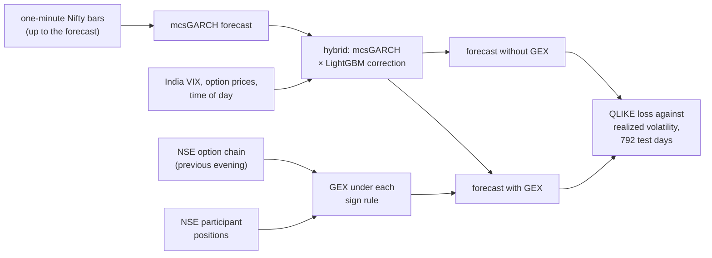
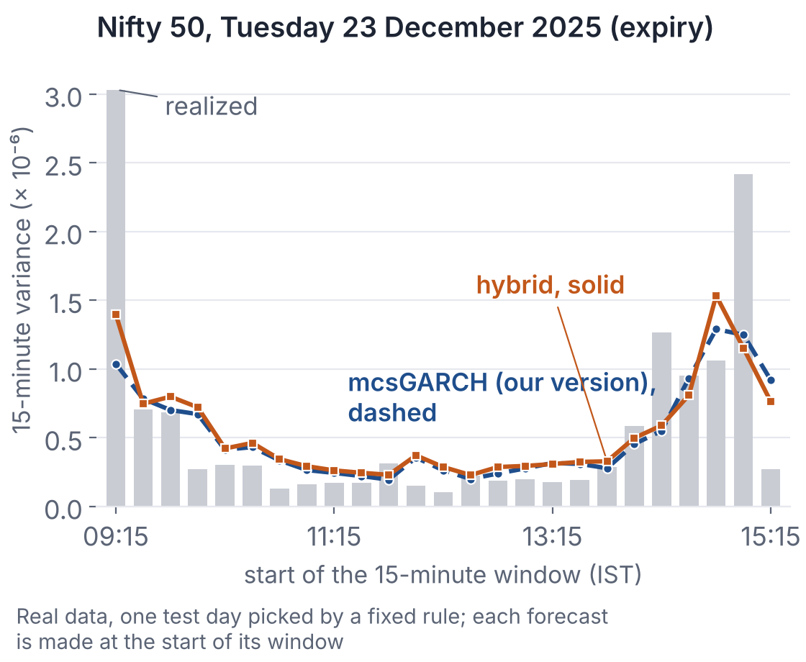

# Nifty Expiry Gamma Exposure

[](https://github.com/ShockXR/Nifty-Expiry-Gamma-Exposure/actions/workflows/tests.yml)

[](LICENSE)


**Does knowing where Nifty options are concentrated help forecast volatility near expiry?**

Chhimwal, Pandey and Pandey ([2025, *Review of Derivatives Research*](https://doi.org/10.1007/s11147-025-09221-8)) studied how volatility, volume and connectedness changed when Nifty and Bank Nifty expiries were separated. This prototype turns their intraday volatility model, mcsGARCH, into a forecasting benchmark and adds estimates of dealer gamma exposure (GEX) from NSE options data. In the Nifty out-of-sample comparison, adding gamma features gave no reliable improvement under any of the three sign rules tested. Recent realized volatility and time of day explained more of the forecast improvement.

Research prototype by Shreyan Thanki, Atharva Bhardwaj and Arjun Bino Nair, November 2026, prepared for Prof. Piyush Pandey and built with extensive AI assistance ([how](#how-this-was-built)).

**What a forecast could know.** GEX is built each evening from NSE's end-of-day option chain (the F&O bhavcopy) and used the next day, so it never sees positions change intraday. Open interest gives the size of positions, but the direction of dealers' exposure must be inferred, so each sign rule assumes who the dealers are: the US convention (dealers long calls, short puts), NSE's "Pro" participants, or the mirror image of NSE's clients. Options data come from NSE's archive; the one-minute index bars that define realized volatility come from a public third-party dataset, checked against NSE's daily highs and lows.

<details>
<summary><b>What is compared, in one diagram</b></summary>



</details>

## The gamma result

**Change in out-of-sample QLIKE loss when GEX is added to the same Nifty forecaster.** All 792 test days; negative = lower loss.

| Sign rule for dealer gamma | Next 15 minutes | Next 30 minutes |
| --- | ---: | ---: |
| US convention | -0.18% | -0.33% |
| NSE Pro participants | -0.10% | -0.41% |
| Mirror of NSE clients | +0.07% | -0.32% |

*QLIKE is a loss for volatility forecasts; lower is better. Each cell compares the hybrid forecaster (mcsGARCH with a LightGBM correction) with and without that GEX set, same days, same horizon. No cell survives a Holm adjustment within its family (adjusted p 0.14 to 1.00), nor does any on expiry days alone. Unsigned gamma does about as well (+0.14% and -0.42%), and a few tenths of a percent is the noise between two random seeds of one model. Source: [docs/MODEL_ITERATIONS_REAL.md](docs/MODEL_ITERATIONS_REAL.md#45-the-gex-ablation-real-data), section 4.5.*

**The strongest check on this null.** In the later hold-out, three GEX sets did appear to help at 30 minutes (-0.63% to -1.10%, passing Holm). But a placebo, GEX from a random earlier day, also lowered loss by 0.52%, and the development window showed nothing. Nor did the sign matter, although the US and Pro rules agree in sign on only 45% of days; a hedging effect should depend on it. The conclusion covers end-of-day GEX proxies from public files, on this market and forecast design. It does not settle whether dealers hedge ([docs/REAL_DATA_RESULTS.md](docs/REAL_DATA_RESULTS.md)).

## Two further findings

**The forecasting gain belongs to mcsGARCH's own information.** On the same 792 test days, the hybrid had 4.4% and 6.6% lower QLIKE than mcsGARCH as the paper specifies it, at 15 and 30 minutes (one-sided Diebold-Mariano p below 0.001; [P116](docs/P116_BENCHMARK_AS_PRINTED.md)). Measured against our own mcsGARCH, recent realized volatility carries about a third of the hybrid's gain and time of day about a quarter ([P106](docs/P106_GAIN_DECOMPOSITION.md)), and five refinements to the mcsGARCH baseline recover it within uncertainty ([P109](docs/P109_MCSGARCH_EXTENSIONS.md)). The refinements were chosen after seeing the test days; a forward test on Nifty days from 4 November 2026, registered on 3 November, has no result yet. These are historical walk-forward forecasts: a fallback rule in our mcsGARCH used later data in two refits covering 42 test days, and dropping those days does not shrink the hybrid's margin ([referee response](docs/REFEREE_RESPONSE_FORECAST.md)).

**The paper replicates on public data, with one open question.** The post-change sample matches closely: exactly 21,239 Nifty one-minute returns, and mcsGARCH alpha 0.0498 and beta 0.9407 against the printed 0.0494 and 0.9410 ([docs/REPLICATION_NSE.md](docs/REPLICATION_NSE.md)).

One question we would value your help with, Prof. Pandey: **could you confirm the dates you used for the pre-change sample?** We matched the post-change tables closely, but our closest match for the earlier tables came from a different window, and we would like to be sure we have read the paper correctly ([docs/P108_BLIND_WINDOW.md](docs/P108_BLIND_WINDOW.md)).

## See it run

Browse the executed [real-data tour](notebooks/01_real_data_tour.ipynb), or draw one test day from committed files (Python 3.10 or newer, a few seconds, no download):

```bash
python -m venv .venv && source .venv/bin/activate   # Windows: .venv\Scripts\activate
pip install -e ".[dev]"
python scripts/demo_forecast_day.py --date 2025-12-23
```

It writes `results/demo/demo_nifty_2025-12-23.html`, a self-contained page to open in a browser. The chart below is the same day.

<p align="center"><a href="docs/figures/nifty_2025-12-23_forecasts.png"></a></p>

*One day only: Tuesday 23 December 2025, the median Tuesday expiry since October 2025 by the day's result, picked by a fixed rule ([docs/DEMO.md](docs/DEMO.md)). Bars: realized variance of each 15-minute window. Lines: forecasts made at the start of each window by our mcsGARCH (dashed) and the hybrid (solid). A single day says nothing about the 792-day comparison above.*

## Validation and reproducibility

```bash
# software tests on synthetic fixtures, no market data needed
pytest
# check every number in this README against the results file it comes from
python scripts/trace_numbers.py
```

The tests run on every pull request (GitHub Actions, Python 3.11 to 3.13 and pinned versions). Raw NSE and vendor files are not committed; [docs/REPRODUCIBILITY.md](docs/REPRODUCIBILITY.md) downloads them, checks their hashes and reruns the studies.

**Further reading**

* Statistical tests: every one of 28,515 tests from 37 studies, with a correction for all at once: [docs/TEST_LEDGER.md](docs/TEST_LEDGER.md)
* A code audit for look-ahead and wrong units, with the defects it found: [reports/CODE_AUDIT.md](reports/CODE_AUDIT.md)
* All real-data results, with hold-out and placebo details: [docs/REAL_DATA_RESULTS.md](docs/REAL_DATA_RESULTS.md)
* The replication, table by table: [docs/REPLICATION_NSE.md](docs/REPLICATION_NSE.md)
* The walk-through days and how they were picked: [docs/DEMO.md](docs/DEMO.md)
* The pitch, with every caveat: [PITCH_PANDEY.md](PITCH_PANDEY.md)
* The previous, fuller README with every result and the document list: [README_FULL.md](README_FULL.md)

## How this was built

The project is the joint work of Shreyan Thanki, Atharva Bhardwaj and Arjun Bino Nair. The code, analyses and documents were produced with extensive AI assistance (Claude, by Anthropic). Every review in the repository, including the referee-style reports, was done by a separate AI agent, not by a person. "Registered" means the plan was committed to git before that study's results were computed; only the forward tests were committed before their data existed. The paywalled 2025 paper is not in this repository. Code: MIT license; data keep their sources' terms.

## References

- Chhimwal, B., Pandey, V. and Pandey, P. (2025). Effect of multiple index derivative expiry on volatility, volume, and connectedness: a tale of two stock indices in India. *Review of Derivatives Research*, 28(3), 14. [doi:10.1007/s11147-025-09221-8](https://doi.org/10.1007/s11147-025-09221-8)
- Engle, R. F. and Sokalska, M. E. (2012). Forecasting intraday volatility in the US equity market: multiplicative component GARCH. *Journal of Financial Econometrics*, 10(1), 54 to 83. [doi:10.1093/jjfinec/nbr005](https://doi.org/10.1093/jjfinec/nbr005)
- Ni, S. X., Pearson, N. D., Poteshman, A. M. and White, J. (2021). Does option trading have a pervasive impact on underlying stock prices? *Review of Financial Studies*, 34(4), 1952 to 1986. [doi:10.1093/rfs/hhaa082](https://doi.org/10.1093/rfs/hhaa082)
- Patton, A. J. (2011). Volatility forecast comparison using imperfect volatility proxies. *Journal of Econometrics*, 160(1), 246 to 256. [doi:10.1016/j.jeconom.2010.03.034](https://doi.org/10.1016/j.jeconom.2010.03.034)

The full list, with verification status, is in [docs/LITERATURE_REVIEW.md](docs/LITERATURE_REVIEW.md).
