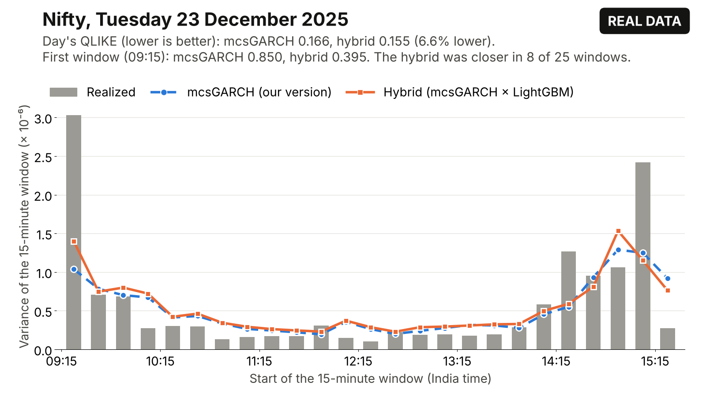

# Nifty Expiry Gamma Exposure

**A research prototype that builds on Chhimwal, Pandey and Pandey (2025, *Review of Derivatives Research*), the study of what happened to Nifty and Bank Nifty after NSE gave them separate expiry days.** It rebuilds the paper's analysis from public NSE files, turns the paper's intraday volatility model (mcsGARCH) into an out-of-sample forecaster, and tests one explanation the paper leaves open: option dealers' hedging, measured as gamma exposure (GEX: how much of the index dealers must buy or sell to stay hedged when it moves).

Research prototype by Shreyan Thanki, November 2026. Every result below comes from **real NSE data** (942 trading days from January 2023 to 2 November 2026, 200 Nifty expiries) unless it is marked [SYNTHETIC]. The work was built with extensive AI assistance; [How this was built](#how-this-was-built) says exactly how.

## What this prototype demonstrates

1. **The paper can be rebuilt from public NSE files.** The "after" sample matches closely: exactly the paper's 21,239 Nifty one-minute returns, and Nifty's mcsGARCH parameters close to the printed values (table below). For the "before" sample, the dates as printed give 82 trading days rather than 64. A 64-day window one year earlier, starting in mid November 2022, reproduces both printed "before" maxima to every decimal. Which dates were used is the first question for the authors.
2. **The paper's model can be turned into a forecaster, and it can be beaten at short horizons.** The paper fits mcsGARCH but does not forecast with it. In an out-of-sample contest on 792 Nifty test days, a hybrid that corrects mcsGARCH with a machine-learning model has **4.4% and 6.6% lower forecast error for the next 15 and 30 minutes than mcsGARCH as the paper specifies it** (p below 0.001). The gain also holds on Bank Nifty and Fin Nifty.
3. **The gain comes from using mcsGARCH's own information better, not from the option market.** Recent realized volatility carries about a third of it and the time of day about a quarter; removing option prices or India VIX changes the forecast error by less than 1%. Five plain fixes to mcsGARCH recover all of the gain. That makes it a result about the paper's own model. The fixes were registered before being tested but chosen after seeing the same days, so a forward test on Nifty days from 4 November 2026, registered in advance, has to confirm them.
4. **Dealer gamma from public files does not improve forecasts, and who the dealers are is the real open question.** The one in-sample pattern that held up (Nifty reverses into the close after evenings when NSE's "Pro" participants, brokers trading their own money, were net short index options) is about positioning, not gamma. Identifying which participants act as dealers on NSE is where knowledge of the Indian market matters most.
5. **The expiry effect sits at the end of the day.** Since Nifty's expiry moved to Tuesday (September 2025), Tuesday's last hour carries 63% more variance than days on which no index option expires. This comparison was made after looking at the data, so it is exploratory.



*One test day, picked by a fixed rule (the median Tuesday expiry since October 2025): realized variance in each 15-minute window (grey bars), our implementation of mcsGARCH (blue) and the hybrid (orange), each forecast made at the start of its window. The headline numbers average over all 792 test days.*

## Results at a glance

**How to read the forecasting numbers.** Forecast error is measured with QLIKE, a standard score for volatility forecasts that punishes forecasts that are too low more than forecasts that are too high. "4.4% better" means the hybrid's average QLIKE is 4.4% below mcsGARCH's.

| Question | What we found | Details |
| --- | --- | --- |
| Does the paper replicate on NSE data? | "After" sample: exactly 21,239 Nifty returns; mcsGARCH alpha 0.0498 and beta 0.9407 against the printed 0.0494 and 0.9410. "Before" sample: the stated dates do not match, while a 64-day window starting between 14 and 23 November 2022 does. | [REPLICATION_NSE.md](docs/REPLICATION_NSE.md), [P108_BLIND_WINDOW.md](docs/P108_BLIND_WINDOW.md) |
| Can mcsGARCH be beaten out of sample? | Yes at 15 and 30 minutes: 4.4% and 6.6% better than the paper's specification. Built on that specification itself, like for like, the hybrid is 5.1% and 7.1% better. | [P116](docs/P116_BENCHMARK_AS_PRINTED.md), [P118](docs/P118_HYBRID_ON_PAPER_MCSGARCH.md) |
| Does it hold on other indices? | Against our implementation of mcsGARCH: Bank Nifty 3.9% and 5.0% better (660 test days), Fin Nifty 4.9% and 6.1% better (604 test days). | [BANKNIFTY_FORECAST.md](docs/BANKNIFTY_FORECAST.md), [THIRD_INDEX_FORECAST.md](docs/THIRD_INDEX_FORECAST.md) |
| Where does the gain come from? | Recent realized volatility (about a third) and the time of day (about a quarter). Option prices and India VIX are each worth less than 1% of mcsGARCH's forecast error. | [P106](docs/P106_GAIN_DECOMPOSITION.md), [P110](docs/P110_GAIN_STRESS_TEST.md) |
| Can plain fixes to mcsGARCH match it? | Five fixes recover 118% and 108% of the hybrid's gain at 15 and 30 minutes, and the hybrid can no longer be told apart from the fixed model (p 0.82 and 0.73). A forward test on new days is registered. | [P109](docs/P109_MCSGARCH_EXTENSIONS.md), [P112](docs/prereg/P112_FORWARD_MCSGARCH_FIXES.md) |
| Does dealer gamma help forecasts? | No, on Nifty, under each of three rules for who is long and who is short. | [REAL_DATA_RESULTS.md](docs/REAL_DATA_RESULTS.md) |
| Is there any dealer effect in sample? | Nifty reverses into the close (about 3 basis points per 100 basis point move), only after evenings when Pro participants were net short. It survives a correction over the 78 headline tests (p = 0.016), not over all 742 related tests. | [FALSIFICATION.md](docs/FALSIFICATION.md), [DEALER_SIGN.md](docs/DEALER_SIGN.md) |
| Where does the expiry effect live? | In the last hour. When Bank Nifty's expiry moved from Thursday to Wednesday, its end-of-day variance moved with it (+0.90 log points in the last 30 minutes). | [EVENT_STUDY.md](docs/EVENT_STUDY.md), [REAL_DATA_RESULTS.md](docs/REAL_DATA_RESULTS.md) |

## What it does not show

* **That the hybrid learned something mcsGARCH could not.** In simulated markets where mcsGARCH is the true model, the hybrid still "significantly" beats a fitted mcsGARCH in 4 of 10 worlds [SYNTHETIC]. A win over a fitted benchmark overstates the evidence of new information, which is why the five fixes matter.
* **That the five fixes work on new data.** They were chosen after seeing the same test days. A one-time forward test on Nifty days from 4 November 2026 is registered to check them.
* **That the headline is free of look-ahead.** One known issue is open: the model's choice between EGARCH and EWMA, and its EWMA floor, use the full sample. Its effect on the headline has not been measured yet.
* **A last-hour or money result.** The last-hour gain fails on Fin Nifty (1.0%, p 0.30) and is kept out of the headline. In money terms the gain is small: about 0.04% of wealth a year for an investor who sizes positions by forecast volatility.
* **Causality.** The expiry rule changes coincide with other market changes, and none of the event-study results reaches 5% under an honest small-sample test.

## Where this could go

These are proposals to discuss with Prof. Pandey, not finished work.

* **Paper A: dealer positioning and the end-of-day reversal on NSE.** Why does Nifty reverse into the close, and why more after Pro participants are net short? The falsification suite and sign estimation exist; a cleaner dealer proxy is missing.
* **Paper B: expiry rules as natural experiments.** The paper's design extended to five NSE expiry-rule changes since 2019, with comparison indices and placebo dates. Verified BSE Sensex expiry dates are missing.
* **A short note on mcsGARCH.** Five fixes that match machine learning at 15 and 30 minutes, written up once the forward test reports.

What would help most: the exact "before" sample dates; a view on whether NSE's "Pro" category is a fair proxy for dealers; and whether intraday option-chain snapshots are available, which would test the hedging story directly on expiry afternoons. The one-page version of this pitch is [PITCH_PANDEY.md](PITCH_PANDEY.md).

## See it in five minutes

Python 3.10 or newer (CI tests 3.11 to 3.13).

```bash
python -m venv .venv
source .venv/bin/activate        # Windows: .venv\Scripts\activate
pip install -e ".[dev]"

# Draw one real test day as a self-contained web page, from committed files only (a few seconds)
python scripts/demo_forecast_day.py --date 2025-12-23

# Run the test suite (synthetic fixtures, no market data needed)
pytest
```

Ready-made pages for three test days are already in [results/demo/](results/demo/) (see [docs/DEMO.md](docs/DEMO.md)). To download the public NSE data and rerun everything, follow [docs/REPRODUCIBILITY.md](docs/REPRODUCIBILITY.md); the full command list is in [README_FULL.md](README_FULL.md#quick-start).

## Read more

| If you want | Read |
| --- | --- |
| The pitch, with every caveat | [PITCH_PANDEY.md](PITCH_PANDEY.md) |
| Every result in detail, the module table and the full document list | [README_FULL.md](README_FULL.md) |
| All real-data results | [docs/REAL_DATA_RESULTS.md](docs/REAL_DATA_RESULTS.md) |
| The replication of the 2025 paper, table by table | [docs/REPLICATION_NSE.md](docs/REPLICATION_NSE.md) |
| The forecasting study and how the model was chosen | [docs/MODEL_ITERATIONS_REAL.md](docs/MODEL_ITERATIONS_REAL.md) |
| A close reading of the 2025 paper | [docs/PAPER_DEEP_DIVE.md](docs/PAPER_DEEP_DIVE.md) |
| Every hypothesis test, with a correction for all of them at once | [docs/TEST_LEDGER.md](docs/TEST_LEDGER.md) |
| The research plan, hypotheses and risks | [RESEARCH_STRATEGY_PANDEY.md](RESEARCH_STRATEGY_PANDEY.md) |
| What went wrong during the build and what changed | [ITERATION_LOG.md](ITERATION_LOG.md) |

## What is in the repository

* **A Python package, `niftygex`:** Black-76 option greeks, dealer gamma exposure under five rules for who is long and who is short, realized volatility measures, mcsGARCH, Diebold-Yilmaz connectedness, an NSE expiry calendar with its rule changes, loaders for NSE's public files, and a walk-forward forecasting and evaluation framework.
* **Studies** in `experiments/` and `scripts/`, each writing its results to `results/` and described in `docs/`.
* **Registered follow-up studies** in `docs/prereg/` and `docs/P1*.md`, each with its analysis plan committed to git before its results were computed.
* **Alternatives** kept out of the main package (a trading layer, a sequence model) in [alternatives/](alternatives/).

## How this was built

Shreyan Thanki directed the project. The code, analyses and documents were produced with extensive AI assistance (Claude, by Anthropic), and most commits list Claude as an author. Every review mentioned in the repository, including the referee-style reports and the blind re-key of the paper's printed numbers, was done by a separate AI agent, not by a person.

Three things keep the results checkable:

* **Every hypothesis test is recorded.** All 28,515 tests from 37 studies are listed in `results/test_ledger.csv`, each with its raw p-value and a p-value corrected for all of them at once ([docs/TEST_LEDGER.md](docs/TEST_LEDGER.md)).
* **Every printed number is traced.** `python scripts/trace_numbers.py` checks each number in the pitch and in this README against the results file it comes from ([docs/number_registry.csv](docs/number_registry.csv)).
* **Plans come before results.** "Registered" here means the analysis plan was committed to git before that study's results were computed. There is no external registry, and only the two forward tests were committed before their data existed.

The test suite runs on every pull request through GitHub Actions, on Python 3.11 to 3.13 and with the pinned versions that produced the committed results.

## Data and license

Raw NSE and vendor files are not committed; the download scripts fetch them from public sources and check each file against a SHA-256 hash ([docs/DATA_ACQUISITION.md](docs/DATA_ACQUISITION.md)). The 2025 paper is paywalled and is not in this repository; it is cited by DOI below. The code is released under the MIT license ([LICENSE](LICENSE)); the data keep their sources' terms.

## Key references

The full list, with verification status, is in [docs/LITERATURE_REVIEW.md](docs/LITERATURE_REVIEW.md).

- Chhimwal, B., Pandey, V. and Pandey, P. (2025). Effect of multiple index derivative expiry on volatility, volume, and connectedness: a tale of two stock indices in India. *Review of Derivatives Research*, 28(3), 14. doi:10.1007/s11147-025-09221-8
- Engle, R. F. and Sokalska, M. E. (2012). Forecasting intraday volatility in the US equity market: multiplicative component GARCH. *Journal of Financial Econometrics*, 10(1), 54 to 83. doi:10.1093/jjfinec/nbr005
- Ni, S. X., Pearson, N. D., Poteshman, A. M. and White, J. (2021). Does option trading have a pervasive impact on underlying stock prices? *Review of Financial Studies*, 34(4), 1952 to 1986. doi:10.1093/rfs/hhaa082
- Baltussen, G., Da, Z., Lammers, S. and Martens, M. (2021). Hedging demand and market intraday momentum. *Journal of Financial Economics*, 142(1), 377 to 403. doi:10.1016/j.jfineco.2021.04.029
- Diebold, F. X. and Yilmaz, K. (2012). Better to give than to receive. *International Journal of Forecasting*, 28(1), 57 to 66. doi:10.1016/j.ijforecast.2011.02.006
- Patton, A. J. (2011). Volatility forecast comparison using imperfect volatility proxies. *Journal of Econometrics*, 160(1), 246 to 256. doi:10.1016/j.jeconom.2010.03.034

## Author

Shreyan Thanki ([@ShockXR](https://github.com/ShockXR))
