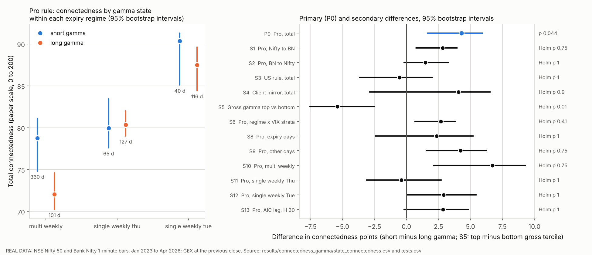

# Does Nifty and Bank Nifty connectedness depend on dealer gamma? (RQ4, P42)

**Everything in the results sections is REAL DATA**: validated third-party 1-minute bars for Nifty 50 and Bank Nifty, and the NSE-based daily gamma (GEX) panel built by this project's pipeline from NSE option chains and NSE's participant-wise open interest file. Nothing is simulated except in the unit tests (`tests/test_connectedness_gamma.py`, synthetic data only). Every number below is copied, rounded, from a CSV file that `experiments/connectedness_gamma.py` writes into `results/connectedness_gamma/`; the file is named under each table and next to each number in the text. The paper we build on (Chhimwal, Pandey and Pandey 2025) does not ask this question.

The primary test was written down before the script was first run on the real data (Section 3), and it is reported as it came out.

## The short answer

On days after the Pro-based gamma measure said "dealers are short gamma", the two indices were a little more connected than on days after it said "long gamma": +4.3 points on a 0 to 200 scale, 95% interval +1.6 to +6.0, permutation p = 0.044. That is just under the usual 0.05 line, in the direction hedging theory predicts. It is fragile. It shrinks once the volatility level is controlled for, it disappears when each day gets an equal vote, it disappears when the input series no longer carries the daily volatility level, it comes mostly from one of the three expiry regimes, and it does not appear under the US sign rule. None of the 13 secondary tests survives the Holm correction, except one with no dealer sign at all: a higher total amount of option gamma goes with *lower* connectedness the next day. We read the evidence that the gamma *sign* matters as weak.

## Findings

1. **Primary test (pre-stated): borderline.** Short-gamma minus long-gamma total connectedness, averaged over the three expiry regimes: +4.29 [1.64, 5.96], permutation p 0.044 (`tests.csv`, row P0).
2. **The volatility level explains part of it.** Comparing only days with similar VIX (stratification) leaves +2.68 [0.66, 3.81], p 0.034 before correction, Holm p 0.41. A day-level regression with log VIX finds nothing: -0.25 [-1.29, 0.78], p 0.70 (S6, S7).
3. **It does not hold up in several checks.** It is +1.21 (p 0.60) on the intraday part of volatility alone, +2.86 (p 0.23) with the sensitivity VAR setting, and its p-value is 0.054 with 40-day blocks (`robustness.csv`, `tests.csv`).
4. **It comes mainly from 2023 to November 2024 (the multi-weekly regime):** +6.72 there, -0.41 in the Thursday single-weekly regime, +2.89 in the Tuesday regime. None of the three is significant on its own (S10 to S12).
5. **Other sign rules:** US convention -0.53 (p 0.98); Client mirror +4.07 (p 0.11, only 39 short days).
6. **Direction of the spillover:** the Nifty to Bank Nifty share rises more (+2.82, p 0.068) than the Bank Nifty to Nifty share (+1.47, p 0.18). Neither survives Holm.
7. **The only Holm survivor has no dealer sign.** Days in the top third of gross gamma (previous close) are less connected than days in the bottom third: -5.39 [-7.53, -2.49], p 0.0008, Holm p 0.010 (S5). Post-hoc checks (not pre-stated) show it holds on non-expiry days (-4.73, p 0.0096) and shrinks to -2.97 (p 0.015) once VIX is controlled. This matches the falsification study: gross gamma behaves like a level variable that goes with calmer markets, not like a dealer signal.

## 1. Words used here

* **Volatility:** how much the index moves. Here, minute by minute, from a model (mcsGARCH, the paper's model) that splits each minute's expected variance into a daily level, a time-of-day pattern and a short-lived intraday part. The **conditional volatility** is the model's expected size of the next minute's move.
* **VAR (vector autoregression):** a model in which each series is predicted from the recent past of *both* series. Here, each index's volatility in a minute is predicted from both indices' volatility in the previous 2 minutes.
* **Connectedness (Diebold and Yilmaz 2012):** take the VAR and ask: if we try to forecast Nifty's volatility 10 minutes ahead, what share of our forecast error comes from surprises in Bank Nifty, and the other way round? These two **cross shares** are the **directional** measures ("Bank Nifty to Nifty" and "Nifty to Bank Nifty"). Their sum is the **total connectedness on the paper's scale** (0 to 200). The standard Diebold-Yilmaz index is half of it. Higher means shocks spread more between the two indices.
* **Option, gamma, dealer.** An option's hedge ratio changes as the index moves; **gamma** is how fast it changes. A **dealer** who sold options and hedges them is **short gamma**: they must buy after the index rises and sell after it falls, which pushes the market further. A dealer who is **long gamma** trades the other way, which damps moves.
* **GEX (gamma exposure):** the total gamma of the front-month Nifty options, in rupees per 1% move. **Gross GEX** adds all options with no sign. **Net GEX** gives calls and puts a sign by a **sign rule** (a guess at who holds them): **Pro** (from NSE's daily file of what proprietary traders hold), **US convention** (dealers long calls, short puts), **Client mirror** (the opposite of what clients hold). **Share** = net GEX / gross GEX of the same chain, between -1 and 1. Below zero means "short gamma" under that rule.
* **Expiry regime:** NSE's expiry rules changed twice in our sample: several weekly expiries per week until 19 November 2024 (**multi_weekly**), one weekly per exchange on Thursday until 31 August 2025 (**single_weekly_thu**), Nifty on Tuesday since then (**single_weekly_tue**).
* **India VIX:** an index of expected volatility from Nifty option prices. We use its value at the previous close.
* **Stratify:** compare like with like. Compute the difference separately inside groups of similar days (same regime, or same regime and same VIX third), then average the differences.
* **p-value:** roughly, how often a difference this large would show up by chance if the gamma state did not matter. Small means "unlikely to be chance", if the test's assumptions hold.
* **Permutation test:** shuffle which days are called "short" and "long" many times, recompute the difference each time, and see how often the shuffled difference is as large as the real one. We shuffle **blocks of 20 consecutive trading days**, because the gamma state lasts several days in a row (shuffling single days would make chance differences look too rare). Blocks stay inside their expiry regime.
* **Bootstrap:** redraw the sample many times (here, blocks of 20 consecutive days within each regime, with replacement), recompute the difference each time, and take the middle 95% of the results as the **95% interval**.
* **Holm correction:** when you run many tests, some look significant by luck. Holm raises each p-value to allow for the number of tests. We apply it to the 13 secondary tests.
* **Post-hoc:** a check we added after seeing the results. It was not planned, so it is weaker evidence.

## 2. The question

Pandey and co-authors show that Nifty and Bank Nifty volatility are strongly connected minute by minute, and that the link weakened when their expiry days were split. Our question (RQ4) is new. When option dealers are short gamma, their hedging trades go with the market. If they hedge both indices at once, a shock to one index could spread to the other more strongly than when they are long gamma. If so, connectedness should be **higher after short-gamma evenings**.

## 3. Pre-stated design (written before the script was run on the real data)

*How to verify the order:* the design below is also in the script's docstring, but neither was committed to git before the first run, so the order rests on the run log, not on a public time stamp.

The primary test is stated here and in the docstring of `experiments/connectedness_gamma.py`. It is reported whatever it shows.

* **Sample.** Trading days from 3 January 2023 to 22 April 2026 (the last day with Bank Nifty minute bars) on which both indices have at least 300 of the 360 bars from 09:15 to 15:14, and on which GEX and India VIX exist at the previous close. The closing auction (from 3 August 2026) falls after the last Bank Nifty bar, so no auction day can enter; the script counts them anyway.
* **Volatility input.** The replication's primary input: mcsGARCH conditional volatility of each index, fitted separately in each expiry regime. The VAR never links one day to the next.
* **Gamma state at the previous close.** The share = net GEX / gross GEX of the same front chain, from the close of the previous trading day. Primary rule: Pro. Short gamma = share below zero.
* **Primary statistic.** Total connectedness on the paper's scale (the two cross shares added, 0 to 200), VAR(2), horizon 10 minutes. Within each expiry regime, short-gamma days are pooled into one VAR and long-gamma days into another; the difference (short minus long) is averaged over the three regimes, weighted by each regime's number of days. A regime is used only if both states have at least 5 days in it.
* **Primary p-value.** Two-sided permutation test. State labels are moved in blocks of 20 consecutive trading days, reordered at random within each regime, 5,000 draws. The p-value is centred on the mean of the permutation distribution.
* **Primary interval.** 95% percentile interval from a moving-block bootstrap of whole days (blocks of 20 days, drawn within each regime), 2,000 draws.
* **Direction expected from hedging theory:** positive (more connectedness after short-gamma evenings). Level 0.05, two-sided.
* **Secondary family, Holm-corrected (13 tests):** S1 Nifty to Bank Nifty and S2 Bank Nifty to Nifty (Pro); S3 US rule and S4 Client-mirror rule; S5 gross gamma, top minus bottom tercile (terciles within regime); S6 Pro stratified by regime and VIX tercile; S7 Pro in a day-level regression with log VIX; S8 Nifty expiry days and S9 other days; S10 to S12 each regime alone; S13 the sensitivity setting (VAR lag chosen by AIC, horizon 30).
* **Robustness, not corrected:** the unstratified (pooled) difference, block lengths 1, 10 and 40 days, and the intraday part of mcsGARCH volatility as the input.
* **Seeds:** master seed 20261102; every draw has its own seed (`run_info.json`).

**Why stratify by regime.** Under the Pro rule, short-gamma evenings were mostly in 2023 to 2024 (Section 4), and connectedness differs a lot between regimes. A plain pooled comparison would mix "short gamma" with "2023 to 2024".

**What was added after the first full run.** Three post-hoc checks (E1 to E3, Section 5.6), the median of the bootstrap draws next to each interval, a table of what the gross-gamma terciles contain, and a file of run-level numbers (`run_summary.csv`). The post-hoc checks use their own seeds, and the pre-stated tests were rerun and came out identical.

## 4. Data and sample

809 days from 3 January 2023 to 22 April 2026, of which 173 are Nifty expiry days (`run_summary.csv`). The first day of 2023 is lost because it has no previous-close GEX. Bank Nifty's minute bars end on 22 April 2026, so the study stops there. As a result, **no closing-auction day is in the sample** (0 days, `robustness.csv`), and the 360-bar session (09:15 to 15:14) would leave out the frozen 15:16 to 15:28 minutes anyway.

How often each rule said "short gamma" (`state_counts.csv`):

| Regime | Days | Nifty expiry days | Short gamma, Pro | Short gamma, US | Short gamma, Client mirror |
| --- | --- | --- | --- | --- | --- |
| multi_weekly (to 19 Nov 2024) | 461 | 98 | 360 | 33 | 30 |
| single_weekly_thu | 192 | 41 | 65 | 18 | 9 |
| single_weekly_tue (to 22 Apr 2026) | 156 | 34 | 40 | 28 | 0 |
| all | 809 | 173 | 465 | 79 | 39 |

*Source: `results/connectedness_gamma/state_counts.csv`.*

Under the Pro rule, 360 of the 465 short-gamma days fall in the first regime. The US and Client-mirror rules say "short" rarely, so their comparisons rest on few days.

The mcsGARCH fits behave as in the replication: intraday persistence (alpha + beta) between 0.993 and 0.999 in every regime and index (`mcsgarch_fits.csv`). The fast VAR code used for the thousands of shuffles gives the same connectedness as the replication's own function, to within 2e-12 points (`run_summary.csv`, `fast_vs_replication_check_max_abs_diff`).

## 5. Results (REAL DATA)

### 5.1 Connectedness in each state

Total connectedness (paper scale, 0 to 200) under the Pro rule, with 95% bootstrap intervals:

| Regime (weight in the average) | Short gamma: days, value [95% interval] | Long gamma: days, value [95% interval] | Short minus long |
| --- | --- | --- | --- |
| multi_weekly (0.570) | 360 days, 78.76 [74.80, 81.12] | 101 days, 72.04 [70.23, 74.60] | +6.72 |
| single_weekly_thu (0.237) | 65 days, 79.94 [77.59, 83.48] | 127 days, 80.34 [79.02, 82.01] | -0.41 |
| single_weekly_tue (0.193) | 40 days, 90.37 [85.09, 91.29] | 116 days, 87.48 [84.42, 89.65] | +2.89 |
| all regimes pooled (no stratification) | 465 days, 78.61 [75.63, 81.03] | 344 days, 77.25 [75.05, 79.25] | +1.36 |

*Source: `state_connectedness.csv` (contrasts `P0_pro_total` and `R_pro_pooled`, measure `total`); differences from `tests.csv` (S10 to S12) and `robustness.csv`.*

Connectedness rose from one regime to the next (about 72 to 79 in the first, about 80 in the second, about 87 to 90 in the third). That is why the pooled comparison (+1.36) is much smaller than the within-regime one: most short-gamma days sit in the regime with the lowest connectedness.

Directional shares under the Pro rule (each is a share of one index's forecast error, in %):

| Regime | Bank Nifty to Nifty: short / long | Nifty to Bank Nifty: short / long |
| --- | --- | --- |
| multi_weekly | 41.11 / 38.70 | 37.64 / 33.35 |
| single_weekly_thu | 38.26 / 40.11 | 41.68 / 40.23 |
| single_weekly_tue | 47.44 / 44.68 | 42.93 / 42.80 |

*Source: `state_connectedness.csv` (contrast `P0_pro_total`, measures `bn_to_nifty` and `nifty_to_bn`).*



*Figure: `results/connectedness_gamma/fig_connectedness_gamma.png`. Left: the first table above. Right: every pre-stated difference with its 95% bootstrap interval.*

### 5.2 Primary test

| Test | Difference (short minus long) | 95% bootstrap interval | Bootstrap median | Permutation p (two-sided) | Shuffle average |
| --- | --- | --- | --- | --- | --- |
| P0: Pro rule, total, regime-stratified | +4.29 | 1.64 to 5.96 | 4.10 | 0.044 | 0.30 |

*Source: `tests.csv`, row P0 (5,000 permutations, 2,000 bootstrap draws).*

In plain words: after a short-gamma evening (Pro rule), Nifty and Bank Nifty were about 4 points more connected than after a long-gamma evening in the same regime, against levels of about 72 to 90. If the gamma state did not matter, a gap this large would turn up in about 4 of 100 block shuffles. "Shuffle average" is the average difference across the shuffles (0.30, close to zero, as it should be).

### 5.3 Secondary tests (Holm-corrected as one family of 13)

| Test | What | Difference | 95% interval | p | Holm p |
| --- | --- | --- | --- | --- | --- |
| S1 | Pro, Nifty to Bank Nifty share | +2.82 | 0.75 to 3.96 | 0.068 | 0.75 |
| S2 | Pro, Bank Nifty to Nifty share | +1.47 | -0.18 to 3.28 | 0.18 | 1 |
| S3 | US convention rule, total (79 short days) | -0.53 | -3.67 to 2.02 | 0.98 | 1 |
| S4 | Client-mirror rule, total (39 short days; Tuesday regime has none) | +4.07 | -2.88 to 6.54 | 0.11 | 0.90 |
| S5 | Gross gamma, top minus bottom third (no sign) | -5.39 | -7.53 to -2.49 | 0.0008 | **0.010** |
| S6 | Pro, stratified by regime and VIX third | +2.68 | 0.66 to 3.81 | 0.034 | 0.41 |
| S7 | Pro, day-level regression with log VIX | -0.25 | -1.29 to 0.78 (Newey-West) | 0.70 | 1 |
| S8 | Pro, Nifty expiry days only | +2.36 | -2.44 to 5.21 | 0.25 | 1 |
| S9 | Pro, all other days | +4.24 | 1.54 to 6.22 | 0.074 | 0.75 |
| S10 | Pro, multi_weekly regime only | +6.72 | 2.10 to 9.30 | 0.072 | 0.75 |
| S11 | Pro, single_weekly_thu regime only | -0.41 | -3.12 to 2.73 | 0.81 | 1 |
| S12 | Pro, single_weekly_tue regime only | +2.89 | 0.06 to 5.47 | 0.20 | 1 |
| S13 | Pro, VAR(10) chosen by AIC, horizon 30 | +2.86 | -0.19 to 4.86 | 0.23 | 1 |

*Source: `tests.csv` (p = block-permutation p; for S7 the interval is the Newey-West 95% interval from `day_level_regression.csv`).*

Several intervals exclude zero although the permutation p is above 0.05. The two methods answer slightly different questions: the bootstrap asks how much the estimate would move in another sample like this one; the permutation asks how often chance alone would produce it. Where they disagree, the permutation test is the stricter of the two, and it is the one we pre-stated for testing.

### 5.4 Controlling for the volatility level

Connectedness rises in volatile periods, and the gamma state could simply be picking those up. Two controls were pre-stated:

* **S6, stratify by VIX.** Inside each regime, days are split into thirds by VIX at the previous close, and short and long days are compared only within the same third. The difference falls from +4.29 to +2.68 (p 0.034 before correction, Holm 0.41). One cell (Thursday regime, lowest VIX third, 29 days) had too few days in one state and was left out (`tests.csv`, `n_days_dropped_small_strata`).
* **S7, day-level regression.** Here each day gets its own VAR and its own connectedness number. These day numbers are then regressed on the short-gamma flag, log VIX at the previous close, the regime and an expiry-day flag:

| Specification | Short-gamma coefficient | Newey-West p | Permutation p | log VIX coefficient (p) | R squared |
| --- | --- | --- | --- | --- | --- |
| regime and expiry flags | -0.08 | 0.88 | 0.93 | not included | 0.271 |
| regime and expiry flags and log VIX(t-1) | -0.25 | 0.63 | 0.70 | +4.54 (0.0001) | 0.2855 |

*Source: `day_level_regression.csv` (809 days; average day connectedness 79.0).*

VIX matters a lot for day-level connectedness. The gamma state adds nothing, with or without VIX. **Why can the pooled and the per-day measures disagree?** The pooled VAR treats all short-gamma days as one long sample. Days with big volatility swings produce big forecast errors, and these dominate the estimate. So the pooled number mostly describes the most turbulent days, while the per-day regression gives every day one vote. The robustness check below points the same way: the effect vanishes when the daily volatility level is taken out of the input.

### 5.5 Robustness of the primary statistic

| Check | Difference | 95% interval | p |
| --- | --- | --- | --- |
| Blocks of 1 day (ordinary shuffle within regime) | +4.29 | 2.13 to 6.41 | 0.026 |
| Blocks of 10 days | +4.29 | 1.59 to 6.26 | 0.033 |
| Blocks of 20 days (the primary test) | +4.29 | 1.64 to 5.96 | 0.044 |
| Blocks of 40 days | +4.29 | 1.83 to 5.78 | 0.054 |
| Pooled, no stratification, shuffles within regime | +1.36 | -1.46 to 4.34 | 0.043 |
| Pooled, no stratification, shuffles across the whole sample | +1.36 | -1.46 to 4.34 | 0.67 |
| Input = intraday part of mcsGARCH volatility only (no daily level, no time-of-day shape) | +1.21 | -2.33 to 4.98 | 0.60 |

*Source: `robustness.csv` (row 3 from `tests.csv`, P0).*

The longer the blocks, the larger the p-value: the gamma state is persistent, and longer blocks allow for more of that. The two pooled rows show why the shuffle must stay inside a regime. A whole-sample shuffle moves short-gamma labels from 2023 into 2025, where connectedness is higher. Its average difference is near zero, while the within-regime shuffle averages -2.31 (`robustness.csv`, `perm_null_mean`).

### 5.6 Post-hoc checks (not pre-stated, not corrected)

The only Holm survivor, S5, compares days by the *amount* of gamma, not its sign. Gross gamma peaks on the evening before an expiry, so its top third is mostly expiry days:

| Gross-gamma third (within regime) | Days | Share that are Nifty expiry days | Average trading days to expiry | Share short gamma (Pro) | Average day-level connectedness |
| --- | --- | --- | --- | --- | --- |
| bottom | 270 | 0.030 | 3.04 | 0.567 | 80.55 |
| middle | 269 | 0.071 | 1.98 | 0.576 | 78.31 |
| top | 270 | 0.541 | 0.58 | 0.581 | 78.17 |

*Source: `gross_tercile_composition.csv`.*

The Pro short-gamma share is about the same in every third, so gross gamma does not explain the Pro result, and the Pro result does not explain S5. We then added three checks:

| Check | Days (state A / state B) | Difference | 95% interval | p |
| --- | --- | --- | --- | --- |
| E1: gross gamma top minus bottom third, non-expiry days only | 124 / 262 | -4.73 | -7.35 to -1.39 | 0.0096 |
| E2: Nifty expiry days minus other days | 173 / 636 | -2.75 | -4.26 to -0.87 | 0.18 |
| E3: gross gamma top minus bottom third, stratified by regime and VIX third | 252 / 235 | -2.97 | -4.82 to -1.21 | 0.015 |

*Source: `posthoc_checks.csv` (5,000 permutations and 2,000 bootstrap draws each; E3 has 2 permutation and 11 bootstrap draws with an empty cell, which are left out).*

So the gross-gamma result is not just "expiry days are different" (E1). It is partly the VIX level (it shrinks from -5.39 to -2.97 in E3). It says nothing about which way dealers hedge. It fits the falsification study's finding that gross gamma acts as a slow-moving level that goes with calmer markets ([FALSIFICATION.md](FALSIFICATION.md), F1).

## 6. How much to trust this

**The primary result is weak evidence that the gamma sign matters.** Reasons for caution, roughly in order of weight:

1. **It is borderline and depends on choices that are all defensible.** p 0.044 with 20-day blocks, 0.054 with 40-day blocks. With the sensitivity VAR it is +2.86 (p 0.23).
2. **It does not survive a fair volatility control.** It drops to +2.68 with VIX strata (Holm 0.41). In the day-level regression it is zero (-0.25, p 0.70).
3. **It sits in the most volatile days and in the daily volatility level.** The per-day measure finds nothing, and the intraday-only input gives +1.21 (p 0.60).
4. **One regime carries it** (+6.72 in 2023 to 2024, -0.41 in the next regime).
5. **The dealer sign is not known.** Under the US rule there is nothing (-0.53). The project's dealer-sign study found no single sign consistent with the data ([DEALER_SIGN.md](DEALER_SIGN.md)). The falsification study found that, under the Pro rule, "GEX" is driven mostly by the daily Pro positioning weights from the participant file, not by option gamma ([FALSIFICATION.md](FALSIFICATION.md)). So "short gamma (Pro)" is better read as "days after Pro traders held net short index options" than as a measured dealer state.
6. **Many tests.** One primary, 13 secondary, 6 robustness checks and 3 post-hoc checks. One nominal p of 0.044 among them is not unusual.

**What would make it convincing:** the same pre-stated test on new data (Bank Nifty bars after April 2026, including the closing-auction period), a positive per-day effect, and an effect that survives the intraday-only input.

## 7. Limits

* **Short sample at the end.** Bank Nifty minute bars stop on 22 April 2026, so the Tuesday regime has 156 days (40 short-gamma days), and the closing-auction period is not covered at all.
* **End-of-day gamma.** The state is known at the previous close only; gamma moves during the day, fastest on expiry day.
* **Nifty gamma only.** The state comes from the Nifty front chain; Bank Nifty's own option gamma is not used (Bank Nifty has had only monthly options since November 2024).
* **Pooled VARs.** All days of one state in one regime share one set of VAR coefficients, which gives the most weight to the most volatile days (Section 5.4).
* **In-sample volatility model.** mcsGARCH is fitted on each regime's own data, as the replication does for its periods.
* **Two indices only.** No Sensex, Fin Nifty or stocks; Nifty and Sensex (now on different expiry weekdays) would be a natural next pair.
* **Association, not cause.** Positioning can respond to expected news, so a link between the state and connectedness would not show that hedging causes it.
* **Bootstrap intervals for small groups can be lopsided** (a value can sit near one end of its own interval, for example 90.37 [85.09, 91.29] for 40 short days in the Tuesday regime). The bootstrap medians in `tests.csv` and `robustness.csv` show how far.

## 8. How to reproduce

```
OMP_NUM_THREADS=1 python experiments/connectedness_gamma.py            # about 1.5 minutes on 4 cores
OMP_NUM_THREADS=1 python experiments/connectedness_gamma.py --quick    # 400 permutations, 200 bootstrap draws
OMP_NUM_THREADS=1 python -m pytest -q tests/test_connectedness_gamma.py
```

The script reads `data/raw/nifty_1min.csv`, `data/raw/banknifty_1min.csv`, `results/pipeline_nse/daily_gex_panel.csv` and `results/pipeline_nse/daily_market.csv` (the first 16 hex digits of each file's SHA-256 are in `run_info.json`). It writes:

| File | Contents |
| --- | --- |
| `tests.csv` | primary and secondary tests, intervals, p-values, Holm p |
| `state_connectedness.csv` | connectedness per state and stratum, total and directional, with bootstrap intervals |
| `day_level_regression.csv` | the day-level regressions (S7) |
| `robustness.csv` | block lengths, pooled versions, intraday input, closing-auction count |
| `posthoc_checks.csv` | E1 to E3 (post-hoc) |
| `gross_tercile_composition.csv` | what the gross-gamma thirds contain |
| `state_counts.csv` | days and short-gamma days per regime and rule |
| `sample_days.csv` | one row per day: states, VIX, day-level connectedness |
| `mcsgarch_fits.csv` | the volatility model per regime and index |
| `run_summary.csv`, `run_info.json` | sample, settings, seeds, timing, input hashes |
| `fig_connectedness_gamma.png` | the figure above |

Seeds: master seed 20261102. Permutation draw i of variant v uses `numpy.random.default_rng([20261102, 1, v, i])`, bootstrap draw i uses `default_rng([20261102, 2, v, i])` (variants in `run_info.json`), so results do not depend on the number of workers. The run reported here took 93 seconds on 4 cores (`run_summary.csv`, `timing_total_s`). The unit tests (synthetic data) check that the fast pooled VAR equals the replication's function, that two simulated VAR regimes with known different spillovers are told apart, and that the block-permutation p-value is roughly uniform when the gamma state does not matter.
