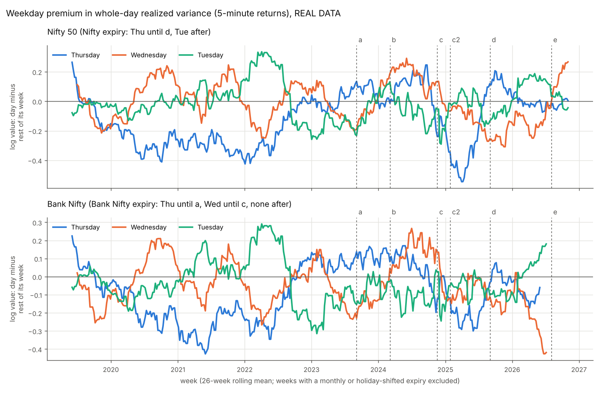
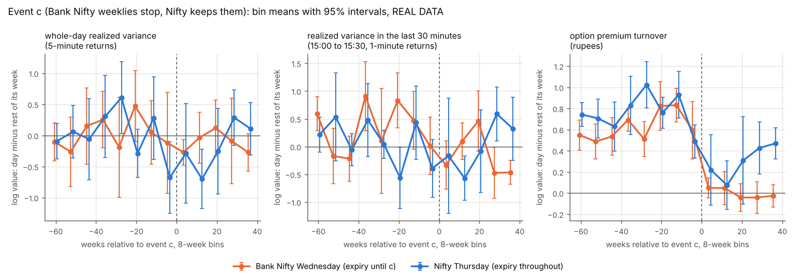
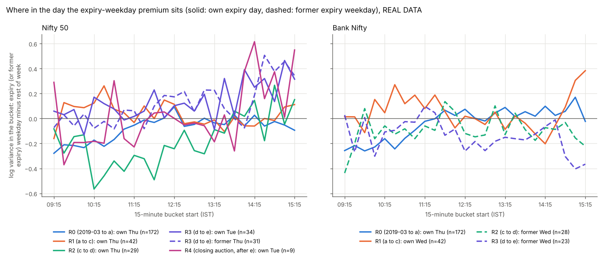
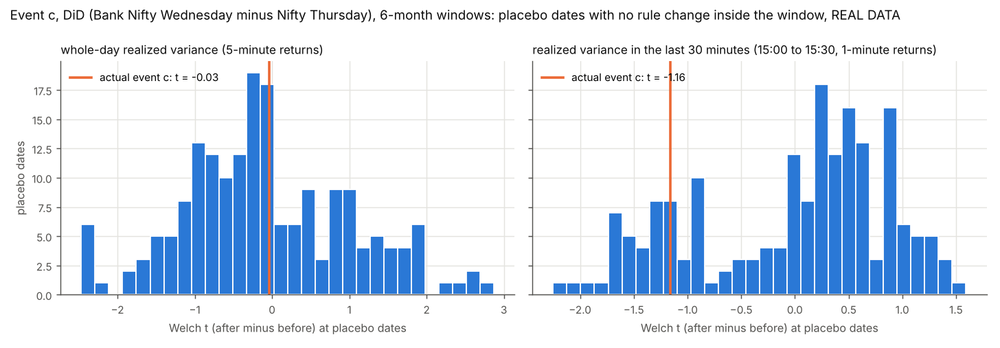

# Expiry-day event study: Nifty 50 and Bank Nifty, 2019 to 2026

This note asks a simple question: **is an index more volatile on its own expiry day than on the other days of the same week, and how did that change each time the expiry rules changed?** It uses five rule changes found in NSE's own files, plus the closing auction that started in August 2026.

**Every number marked REAL DATA comes from a file written by `experiments/expiry_event_study.py`** into `results/event_study/` (the file is named next to each table) or into `results/event_study_stdout.txt`. Nothing was tuned to get a result. The main test was fixed before any result was seen (Section 3.6), and everything added later is labelled as such.

The anchor paper is Chhimwal, Pandey and Pandey (2025), which studies event b below. Its replication on real data is in [REPLICATION_NSE.md](REPLICATION_NSE.md) and is not repeated here; Section 5.4 only looks at the paper's windows through this note's lens.

## Findings

1. **The pre-specified main test finds nothing (REAL DATA).** At event c (Bank Nifty weekly options stopped in November 2024 while Nifty kept its weeklies), the difference-in-differences in whole-day realized variance (Bank Nifty Wednesday minus Nifty Thursday, 6 months each side) changed by **-0.01 log points, 95% interval -0.61 to +0.55, HAC p 0.971, placebo p 0.962** (`event_tests.csv`). The smallest change this test could detect with 80% power is 0.84 log points, so it only rules out large effects. The main reason for the null is that in the year before c, Bank Nifty's expiry Wednesday was not more volatile over the whole day than the rest of its week (+0.04, interval -0.12 to +0.21, 42 weeks). There was little to remove.
2. **Trading moved cleanly with every rule change (REAL DATA).** The extra option premium turnover on the expiry weekday rose by +0.51 log points (interval +0.40 to +0.63) on Bank Nifty's new Wednesday at event a, fell by -0.72 (-0.84 to -0.58) on that Wednesday at event c, and moved from Nifty's Thursday (-0.86, -0.96 to -0.76) to its new Tuesday (+0.84, +0.75 to +0.93) at event d (6-month windows). The rules clearly shifted where trading happened.
3. **Where expiry volatility does show up is the end of the day (REAL DATA).** On Bank Nifty's expiry day the last 30 minutes (15:00 to 15:30) carried about 1.38 times the variance of the same half hour on the other days of the week, both when it expired on Thursday (October 2022 to August 2023: +0.32, +0.09 to +0.56) and on Wednesday (September 2023 to November 2024: +0.32, +0.09 to +0.55). The strongest evidence that this premium follows the expiry is event a: the Wednesday-minus-Thursday gap in Bank Nifty's last 30 minutes rose by **+1.14 (+0.50 to +1.73, placebo p 0.005)**, and in the last hour by +0.92 (+0.40 to +1.41, placebo p 0.005). Whole-day variance did not move (+0.12, -0.23 to +0.49, placebo p 0.459).
4. **Before 2023 the expiry day was calmer, not wilder (REAL DATA).** From March 2019 to August 2023, Nifty's expiry Thursday had 0.85 times the whole-day variance of the rest of its week (-0.16, -0.24 to -0.08, 172 weeks), mostly in the first hour (-0.26, -0.35 to -0.17). Since late 2022 the whole-day premium has been close to zero for both indices in every regime.
5. **Event d: Nifty's new Tuesday gained an end-of-day premium, but Thursday did not lose one (REAL DATA).** In the 6 months after Nifty moved to Tuesday, Tuesday's last-hour premium rose by +0.49 (+0.27 to +0.71, placebo p 0.005) and its last-30-minute premium by +0.39 (+0.07 to +0.70, placebo p 0.005). Thursday's last 30 minutes did not calm down (+0.29, -0.05 to +0.64), and Bank Nifty's Thursday moved the same way as Nifty's (difference +0.08, -0.16 to +0.30). With 12-month windows the Tuesday rise is smaller and not significant (last hour +0.20, -0.06 to +0.44, HAC p 0.131).
6. **A possible confounder that this repository cannot check: BSE's Sensex expiry (post hoc, REAL DATA for the premia, unverified for the dates).** End-of-day premia also appear on weekdays when no NSE index expires, and those weekdays match the weekday on which BSE's Sensex weekly options are reported to have expired (Friday in 2023 and 2024, Tuesday from January to August 2025, Thursday from September 2025). Nifty's last 30 minutes: Friday +0.27 (+0.14 to +0.40) from September 2023 to November 2024; Tuesday +0.25 (+0.10 to +0.41) from November 2024 to August 2025, before Nifty itself moved to Tuesday; Thursday +0.43 (+0.21 to +0.64) after September 2025, when Nifty no longer expired on Thursday. Bank Nifty shows the same pattern from September 2023 to November 2024 and after September 2025, but not in between (its Friday, +0.23, is larger than its Tuesday, +0.07). No BSE files are in this repository, so this is a hypothesis to test, not a finding. If it holds, part of event d's Tuesday rise was already there before d.
7. **Two measurement points that matter for the paper (REAL DATA).** (a) The per-minute Rogers-Satchell measure, which the paper uses, shows an expiry premium that 5-minute realized variance does not: on Nifty's expiry Thursday from September 2023 to November 2024, +0.25 (+0.12 to +0.37) with Rogers-Satchell against -0.01 (-0.23 to +0.21) with 5-minute returns. (b) In the paper's stated window, Nifty's Thursday Rogers-Satchell level rose by +0.43 log points, but all Nifty days rose by +0.24; the part that is specific to Thursday is +0.25 (-0.01 to +0.52). Bank Nifty's Wednesday premium over the rest of its week is close to zero in both the stated window (-0.05) and the window inferred in REPLICATION_NSE.md (+0.04).
8. **The usual p-values are too optimistic here (REAL DATA).** For Friday, a weekday that no NSE rule change targeted, HAC p-values were below 0.05 in 20%, 34% and 46% of tests (3, 6 and 12 month windows), and bootstrap intervals excluded zero in 14%, 26% and 40%. The placebo-date p-value rejected in 6% and 9% (3 and 6 months), close to the nominal 5%. So a result is treated as solid here only when its placebo p is small.
9. **The closing auction (from 3 August 2026) does not change the Tuesday result (REAL DATA).** Nifty's Tuesday last-30-minute premium is +0.42 (+0.21 to +0.64, 34 weeks) from event d to the auction, +0.44 (+0.25 to +0.62, 43 weeks) with the auction weeks included, and +0.50 (+0.01 to +0.94, 9 weeks) on auction weeks alone.

## Words used below

* **Realized variance (RV):** the sum of squared returns over a period. "5-minute RV" sums squared 5-minute log returns over the day. It is the standard measure of how much the index moved.
* **Rogers-Satchell (RS):** a variance estimate built from each bar's open, high, low and close (Rogers and Satchell 1991). Summed over 1-minute bars, it is the measure the anchor paper uses.
* **Log points and ratios:** most results are differences of logs. A value of +0.30 means about 1.35 times (exp(0.30)), and -0.30 means about 0.74 times.
* **Week-relative premium:** the log value on one weekday minus the average log value of the other trading days of the same calendar week. If the whole week is volatile (a crisis, a budget week), that cancels. A premium of zero means the day looks like the rest of its week.
* **Event, before and after:** each rule change defines an event week. We compare the weekly premia in the weeks before with the weeks after (3, 6 or 12 months each side).
* **Difference-in-differences (DiD):** the change for the treated series minus the change for a comparison series that should be unaffected. It removes changes that hit both.
* **95% interval:** the range from a block bootstrap (resampling blocks of 4 consecutive weeks). Roughly, the values the data cannot rule out.
* **HAC p:** a p-value from a regression standard error that allows correlation between nearby weeks (Newey and West 1987).
* **Placebo p:** the same test run at about 184 dates where no rule changed; the share of those placebo results that are at least as large as the real one. It asks "how unusual is this change compared with the changes that happen anyway?" With 184 placebo dates the smallest possible value is about 0.005.
* **MDE80:** the smallest true change the test would detect 80% of the time (2.8 times the HAC standard error).
* **Pre-trend p:** whether the premium was already drifting in the "before" weeks. A small value warns that a before/after difference might be a trend that started earlier.

## 1. The events, as found in the data

The dates come from NSE's F&O bhavcopies: an expiry happened on a day if options expiring that day traded that day, and it was a monthly expiry if an index future also expired that day. A change of weekday is confirmed only after three expiries on the new weekday. The closing auction was found in the minute bars, not in the bhavcopies.

**Table 1. Events (REAL DATA, `events.csv`, `schedule_changes_detected.csv`)**

| event | what changed | last old expiry | first new expiry | first treated week (Monday) |
| --- | --- | --- | --- | --- |
| a | Bank Nifty weekly expiry moves Thursday to Wednesday | Thu 24 Aug 2023 | Wed 6 Sep 2023 | 4 Sep 2023 |
| b | Bank Nifty monthly expiry moves Thursday to Wednesday (the paper's event) | Thu 29 Feb 2024 | Wed 27 Mar 2024 | 4 Mar 2024 |
| c | Bank Nifty weekly options stop; Nifty keeps weeklies | Wed 13 Nov 2024 | none | 18 Nov 2024 |
| c2 | Bank Nifty monthly expiry moves from Wednesday to the last Thursday | Tue 24 Dec 2024 (Wed 25 Dec was a holiday) | Thu 30 Jan 2025 | 27 Jan 2025 |
| d | Nifty weekly expiry moves Thursday to Tuesday; both monthlies move to Tuesday | Thu 21 Aug 2025 (weekly), Thu 28 Aug 2025 (monthly) | Tue 2 Sep 2025 (weekly), Tue 30 Sep 2025 (monthly) | 1 Sep 2025 |
| e | Closing auction sets the official close: the Nifty minute index is frozen from about 15:16 to 15:28 and the 15:29 bar jumps | n/a | n/a | 3 Aug 2026 (63 trading days to 2 Nov 2026) |

Event c agrees with SEBI's circular of 1 October 2024 (one benchmark weekly expiry per exchange from 20 November 2024), and event d agrees with NSE circular 108/2025 (first Tuesday expiry on 2 September 2025); both are listed in [LITERATURE_REVIEW.md](LITERATURE_REVIEW.md). For events a and b this note reports the dates as found; it does not cite a circular for them. Wednesday 20 November 2024 is not a trading day in our files, so the first Wednesday without a Bank Nifty weekly is 27 November 2024 (a monthly expiry week, excluded below) and the first clean one is 4 December 2024.

**Regimes used to describe the premium at each stage**

| regime | dates | Nifty expiry | Bank Nifty expiry |
| --- | --- | --- | --- |
| R0 | 4 Mar 2019 to 3 Sep 2023 | Thursday | Thursday |
| R0v | 17 Oct 2022 to 3 Sep 2023 (the part of R0 covered by bhavcopies) | Thursday | Thursday |
| R1 | 4 Sep 2023 to 17 Nov 2024 (a to c) | Thursday | Wednesday |
| R2 | 18 Nov 2024 to 31 Aug 2025 (c to d) | Thursday | monthly only |
| R3 | 1 Sep 2025 to 2 Aug 2026 (d to e) | Tuesday | monthly only |
| R3+ | 1 Sep 2025 to 2 Nov 2026 (R3 plus the auction days) | Tuesday | monthly only |
| R4 | 3 Aug 2026 to 2 Nov 2026 (closing auction only) | Tuesday | no data |

## 2. Data

| source | what | span |
| --- | --- | --- |
| `data/raw/bhavcopy/`, `data/raw/extra_2022/bhavcopy/` | NSE F&O bhavcopies, NIFTY and BANKNIFTY rows only | 994 trade dates, 20 Oct 2022 to 2 Nov 2026 |
| `data/raw/nifty_1min.csv` | third-party 1-minute Nifty 50 bars (provenance in `minute_bars_source.json`) | 2,368 usable days, 3 Apr 2017 to 2 Nov 2026 |
| `data/raw/banknifty_1min.csv` | third-party 1-minute Bank Nifty bars | 2,297 usable days, 2 Jan 2017 to **22 Apr 2026** |
| `data/raw/index_daily.csv` | NSE's official daily index file, used to define official trading days | 944 days, 2 Jan 2023 to 2 Nov 2026 |

(REAL DATA, `results/event_study_stdout.txt`.) Points to know:

* **Bank Nifty bars end on 22 April 2026.** Bank Nifty results after event d stop there, and there is no Bank Nifty in R4.
* **Before the first bhavcopy (20 October 2022)** the expiry calendar comes from a rule: Thursday, moved back to the previous trading day when Thursday is a holiday, and monthly on the last scheduled Thursday of the month. On the overlap the rule reproduces every bhavcopy expiry and every monthly label (150 of 150 Nifty dates to 31 Aug 2025, 46 of 46 Bank Nifty dates to 31 Aug 2023).
* **Days dropped:** weekend special sessions, days with fewer than 370 of 375 bars, days with more than 20% flat bars, and (from 2023) days that are not official trading days: 10 Nifty and 14 Bank Nifty days.
* **The minute bars were validated** against NSE's official daily values in [REPLICATION_NSE.md](REPLICATION_NSE.md) (October 2022 to June 2024). Earlier years are not validated in this study.
* **Volume is turnover in rupees, not contracts,** because lot sizes changed several times (Table 2). Premium turnover is the notional turnover minus strike times quantity. NSE reports option turnover as (strike + premium) times quantity.

**Table 2. Option lot size by period (REAL DATA, `lot_sizes.csv`; daily median over traded contracts)**

| index | lot | from | to | source |
| --- | --- | --- | --- | --- |
| Nifty 50 | 50 | 20 Oct 2022 | 25 Apr 2024 | inferred from turnover |
| Nifty 50 | 25 | 26 Apr 2024 | 26 Dec 2024 | inferred, then printed in the file from 8 Jul 2024 |
| Nifty 50 | 75 | 27 Dec 2024 | 22 Dec 2025 | printed in the file |
| Nifty 50 | 65 | 23 Dec 2025 | 2 Nov 2026 | printed in the file |
| Bank Nifty | 25 | 20 Oct 2022 | 6 Jul 2023 | inferred from turnover |
| Bank Nifty | 15 | 7 Jul 2023 | 7 Jan 2025 | inferred, then printed in the file from 8 Jul 2024 |
| Bank Nifty | 30 | 8 Jan 2025 | 26 Jun 2025 | printed in the file |
| Bank Nifty | 35 | 27 Jun 2025 | 30 Dec 2025 | printed in the file |
| Bank Nifty | 30 | 31 Dec 2025 | 2 Nov 2026 | printed in the file |

A new lot size applies to newly listed contracts first, so the daily median switches only when most traded contracts are new ones. The tripling of Nifty's lot shortly after event c is part of the confounding at c (Section 7).

## 3. Method in plain words

### 3.1 Daily measures

For each index and day (all from the 1-minute bars unless stated):

* `rv5`: whole-day realized variance from 5-minute returns. **The primary measure.**
* `rv1`: the same from 1-minute returns.
* `rs`: Rogers-Satchell variance summed over the day's 1-minute bars (the paper's measure).
* `rv_first_hour` (09:15 to 10:15), `rv_midday` (10:15 to 14:30), `rv_last_hour` (14:30 to 15:30) and `rv_last30` (15:00 to 15:30), from 1-minute returns.
* `corr5_z`: the correlation of Nifty's and Bank Nifty's 5-minute returns that day (Fisher z scale). A day-level stand-in for the paper's connectedness; Diebold-Yilmaz connectedness was not computed here.
* `opt_premium`, `opt_notional`, `fut_notional`: turnover in rupees from the bhavcopies.

### 3.2 The week-relative premium

For a chosen weekday (say Wednesday), each week gives one number: log(Wednesday's value) minus the average log value of that week's other trading days. Weeks need at least two other trading days. This removes anything that moved the whole week. The cost is that a change on one weekday also moves the baseline of the others a little.

### 3.3 Which weeks are used

The main samples use "clean weekly" weeks: no monthly expiry of either index and no expiry moved by a holiday. Monthly weeks are excluded because event b changed only monthly weeks (they are analysed separately) and because, after event c, Bank Nifty still has a monthly expiry. Event b uses the monthly weeks only.

### 3.4 Comparisons at each event

For each event: the treated weekday on its own (for example Bank Nifty's Wednesday at c), the old weekday, the "switch" (new weekday minus old weekday, which asks whether the premium follows the expiry), and DiDs against the other index. At event c the main DiD is Bank Nifty Wednesday minus Nifty Thursday (each index's own expiry weekday before c), and a second DiD compares Bank Nifty Wednesday with Nifty Wednesday. Windows are 3, 6 and 12 months each side and are cut at neighbouring events, so no window spans two rule changes on the same weekday.

### 3.5 Tests

Each comparison reports: the before and after means, the change with a 95% circular block bootstrap interval (blocks of 4 weeks, based on Künsch 1989), the HAC p (Newey and West 1987, 4 lags), the Mann-Whitney p, the placebo p (Welch t at all usable dates with no rule change inside the window; reported only when those dates contain at least 3 non-overlapping windows), MDE80, a pre-trend test, and Benjamini-Hochberg q-values within each window. For the DiDs a day-level regression with index-by-week fixed effects and standard errors clustered by week gives a second estimate. Friday serves as a negative control (Section 6.2).

### 3.6 What was fixed in advance and what changed

The primary outcome (rv5, 6-month windows, the DiD at event c) was fixed before any result was seen. All changes made afterwards are in the design log at the end of `results/event_study_stdout.txt`. In short: the monthly label of the rule-based calendar was corrected after the overlap check; the moving-block bootstrap was replaced by the circular one because it shifted intervals; the bootstrap block was capped for very small samples; the placebo test was studentized and suppressed when too few independent windows exist; a table of first-hour and last-hour shares was dropped because the whole-day excess was near zero; the closing auction was added as event e after the coordinator flagged it; and the frequency diagnostics (Section 5.7) and the all-weekday end-of-day table (Section 5.6) were added after seeing results and are labelled post hoc.

## 4. Figures (REAL DATA)



*Figure 1 (`fig1_weekday_premium_timeline_rv5.png`): 26-week rolling mean of the week-relative premium for Thursday, Wednesday and Tuesday, with the events marked. `fig1b_weekday_premium_timeline_last30.png` and `fig1c_weekday_premium_timeline_premium_turnover.png` show the same for the last 30 minutes and for premium turnover.*



*Figure 2 (`fig2_event_c_did.png`): event c in 8-week bins for whole-day RV, the last 30 minutes and premium turnover. Turnover drops sharply on Bank Nifty's Wednesday; volatility bins are noisy.*



*Figure 3 (`fig3_diurnal_premium.png`): the week-relative premium in each 15-minute bucket, by regime. Comparing a weekday with the rest of its week also removes the usual intraday pattern of volatility (Andersen and Bollerslev 1997), so the lines show only what is special about that weekday. The expiry-day premium sits mainly in the last hour; before 2023 Nifty's expiry Thursday was calmer than its week in the morning.*



*Figure 4 (`fig4_placebo_c.png`): the event c DiD t statistic against the placebo dates. For whole-day RV the actual value (-0.03) sits in the middle of the placebo distribution.*

## 5. Results (REAL DATA)

All values are week-relative log premia or changes in them, with 95% bootstrap intervals in brackets.

### 5.1 The premium in each regime

**Table 3. Own expiry-day premium by regime, clean weekly weeks (REAL DATA, `premium_by_regime.csv`, `summary_tables.md`)**

| index | regime | weeks | whole day (rv5) | Rogers-Satchell | first hour | last 30 minutes | premium turnover |
| --- | --- | --- | --- | --- | --- | --- | --- |
| Nifty 50 | R0 Thu | 172 | -0.16 [-0.24, -0.08] | -0.09 [-0.15, -0.04] | -0.26 [-0.35, -0.17] | -0.06 [-0.15, +0.03] | +0.27 [+0.20, +0.34] (34 weeks) |
| Nifty 50 | R0v Thu | 34 | +0.05 [-0.09, +0.21] | +0.08 [-0.03, +0.18] | -0.04 [-0.18, +0.11] | +0.02 [-0.18, +0.21] | +0.27 [+0.20, +0.34] |
| Nifty 50 | R1 Thu | 42 | -0.01 [-0.23, +0.21] | +0.25 [+0.12, +0.37] | -0.02 [-0.19, +0.14] | +0.11 [-0.14, +0.34] | +0.75 [+0.66, +0.83] |
| Nifty 50 | R2 Thu | 29 | -0.15 [-0.49, +0.15] | +0.09 [-0.08, +0.27] | -0.18 [-0.42, +0.04] | +0.04 [-0.29, +0.37] | +0.30 [+0.17, +0.43] |
| Nifty 50 | R3 Tue | 34 | +0.06 [-0.08, +0.20] | +0.08 [+0.02, +0.14] | +0.04 [-0.13, +0.26] | +0.42 [+0.21, +0.64] | +0.49 [+0.46, +0.53] |
| Bank Nifty | R0 Thu | 172 | -0.11 [-0.19, -0.03] | -0.05 [-0.11, +0.01] | -0.24 [-0.34, -0.16] | +0.11 [+0.00, +0.21] | +0.35 [+0.28, +0.42] (34 weeks) |
| Bank Nifty | R0v Thu | 34 | +0.09 [-0.06, +0.23] | +0.14 [+0.05, +0.24] | -0.01 [-0.12, +0.09] | +0.32 [+0.09, +0.56] | +0.35 [+0.28, +0.42] |
| Bank Nifty | R1 Wed | 42 | +0.04 [-0.12, +0.21] | +0.15 [+0.06, +0.23] | +0.04 [-0.16, +0.26] | +0.32 [+0.09, +0.55] | +0.63 [+0.56, +0.70] |
| Bank Nifty | R2 former Wed | 28 | -0.13 [-0.30, +0.05] | -0.16 [-0.24, -0.07] | -0.28 [-0.44, -0.10] | -0.19 [-0.45, +0.09] | -0.00 [-0.04, +0.04] |
| Bank Nifty | R3 former Wed (to 22 Apr 2026) | 23 | -0.18 [-0.42, +0.02] | -0.15 [-0.28, -0.03] | -0.11 [-0.37, +0.12] | -0.40 [-0.61, -0.18] | -0.00 [-0.07, +0.07] |

Turnover data start in October 2022, so the R0 turnover column covers R0v only. What the table says:

* Whole-day variance on the expiry day has not been above the rest of the week in any regime. Before 2023 it was below.
* Turnover on the expiry day was 1.3 to 2.1 times the rest of the week while the index had weekly expiries, and the premium vanished on Bank Nifty's Wednesday once its weeklies stopped.
* The last 30 minutes carry a clear premium on Bank Nifty's expiry day (R0v, R1) and on Nifty's new Tuesday (R3), but not on Nifty's Thursday expiry in R0v to R2.

`own_premium_by_halfyear.csv` shows the same by half-year: Nifty's whole-day expiry-day premium was negative from 2019H2 to 2022H1 (for example -0.39, -0.55 to -0.22, in 2020H1) and every half-year from 2022H2 onward has an interval that includes zero.

Median turnover (REAL DATA, `volume_descriptives.csv`, Rs crore of option premium per day): Nifty expiry days 18,338 (R0v), 32,205 (R1), 42,724 (R2), 66,772 (R3); Nifty's other days 13,861, 16,273, 31,704 and 40,527. Between 77% and 88% of Nifty's expiry-day premium turnover is in the contract expiring that day.

### 5.2 Event c: Bank Nifty loses its weekly expiry (the main test)

**Table 4. Event c, 6-month windows unless stated (REAL DATA, `event_tests.csv`, `did_day_regressions.csv`)**

| comparison | measure | weeks before/after | change [95% interval] | HAC p | placebo p | MDE80 | pre-trend p |
| --- | --- | --- | --- | --- | --- | --- | --- |
| **DiD: BN Wed minus Nifty Thu** | **rv5 (primary)** | 16/17 | **-0.01 [-0.61, +0.55]** | **0.971** | **0.962** | 0.84 | 0.373 |
| DiD: BN Wed minus Nifty Thu | rv5, 3 months | 9/9 | +0.12 [-0.71, +0.91] | 0.790 | 0.822 | 1.26 | 0.588 |
| DiD: BN Wed minus Nifty Thu | rv5, 12 months | 33/28 | -0.13 [-0.66, +0.42] | 0.644 | n/a | 0.78 | 0.845 |
| same DiD, day-level regression | rv5 | 33 weeks | +0.000 (se 0.382) | 1.000 | | | |
| same DiD, day-level regression | rv5, 12 months | 61 weeks | -0.123 (se 0.289) | 0.671 | | | |
| BN Wednesday alone | rv5 | 16/17 | -0.17 [-0.50, +0.17] | 0.365 | 0.681 | 0.51 | <0.001 |
| BN Wednesday alone | rv5, 12 months | 33/28 | -0.26 [-0.50, -0.02] | 0.029 | n/a | 0.33 | 0.186 |
| Nifty Thursday alone | rv5 | 16/18 | -0.16 [-0.67, +0.38] | 0.584 | 0.508 | 0.80 | 0.266 |
| DiD: BN Wed minus Nifty Wed | rv5 | 16/17 | +0.06 [-0.17, +0.33] | 0.672 | 0.670 | 0.39 | 0.002 |
| DiD: BN Wed minus Nifty Thu | last 30 minutes | 16/17 | -0.46 [-1.40, +0.35] | 0.280 | 0.238 | 1.19 | 0.004 |
| DiD: BN Wed minus Nifty Thu | last 30 minutes, 12 months | 33/28 | -0.56 [-1.24, +0.12] | 0.125 | n/a | 1.02 | 0.205 |
| BN Wednesday alone | last 30 minutes | 16/17 | -0.42 [-0.83, -0.01] | 0.055 | 0.081 | 0.61 | <0.001 |
| BN Wednesday alone | last 30 minutes, 12 months | 33/28 | -0.54 [-0.90, -0.16] | 0.007 | n/a | 0.55 | 0.787 |
| Nifty Thursday alone | last 30 minutes | 16/18 | +0.00 [-0.59, +0.59] | 0.996 | 0.995 | 0.82 | 0.384 |
| Nifty Wednesday alone | last 30 minutes | 16/17 | -0.32 [-0.72, +0.07] | 0.092 | 0.022 | 0.52 | 0.258 |
| BN Wednesday alone | premium turnover | 16/17 | -0.72 [-0.84, -0.58] | <0.001 | n/a | 0.17 | 0.067 |
| Nifty Thursday alone | premium turnover | 16/18 | -0.54 [-0.73, -0.35] | <0.001 | n/a | 0.32 | 0.037 |
| DiD: BN Wed minus Nifty Thu | premium turnover | 16/17 | -0.19 [-0.39, +0.02] | 0.107 | n/a | 0.32 | 0.459 |
| DiD: BN Wed minus Nifty Thu | premium turnover, 12 months | 33/28 | -0.23 [-0.41, -0.03] | 0.029 | n/a | 0.29 | 0.194 |
| DiD: BN Wed minus Nifty Thu | daily correlation (z) | 16/17 | +0.25 [-0.00, +0.51] | 0.036 | 0.092 | 0.34 | 0.135 |

How to read it:

* **Whole day:** nothing changed beyond noise, in any window or specification.
* **Last 30 minutes:** Bank Nifty's Wednesday got calmer at the end of the day, but so did Nifty's Wednesday, while Nifty's Thursday did not change. The DiD against Nifty Thursday points the same way (-0.46) but is too noisy to separate from zero (MDE80 1.19). The Bank Nifty Wednesday series also had a strong pre-trend in the 6-month window (p < 0.001).
* **Turnover:** Nifty's Thursday turnover premium also fell, although Nifty kept its weeklies. Nifty's other days grew faster than its expiry day (Section 5.1), which is consistent with the rest of the SEBI package (Section 7). This makes Nifty an imperfect control for c.
* **Correlation:** the two indices moved together more on Wednesdays after c (+0.25), which fits the earlier finding that they decoupled on Bank Nifty's expiry Wednesday (R1: -0.10, -0.16 to -0.05, HAC p < 0.001). The placebo p is 0.092, so this is suggestive only.

**Table 5. Robustness of the primary DiD (rv5, BN Wed minus Nifty Thu; REAL DATA, `robustness_event_c.csv`)**

| variant | 6 months | 12 months |
| --- | --- | --- |
| main | -0.01 [-0.62, +0.54], p 0.971 | -0.13 [-0.66, +0.42], p 0.644 |
| baseline excludes the other index's expiry days | +0.04 [-0.53, +0.55], p 0.889 | -0.12 [-0.62, +0.40], p 0.658 |
| weeks with at least 3 other trading days | +0.05 [-0.58, +0.62], p 0.868 | -0.10 [-0.67, +0.46], p 0.715 |
| weekly values winsorized at 2.5% and 97.5% | +0.06 [-0.51, +0.60], p 0.827 | -0.13 [-0.62, +0.38], p 0.616 |
| bootstrap blocks of 2 weeks | -0.01 [-0.64, +0.56] | -0.13 [-0.62, +0.35] |
| bootstrap blocks of 8 weeks | -0.01 [-0.65, +0.55] | -0.13 [-0.65, +0.42] |
| HAC with 8 lags | p 0.964 | p 0.640 |
| monthly-expiry weeks included | +0.19 [-0.46, +0.81], p 0.552 | +0.07 [-0.51, +0.67], p 0.829 |

(The bootstrap interval of the main row differs slightly from Table 4 because this table draws its own bootstrap.) No variant comes near significance.

### 5.3 Event a: Bank Nifty's weekly moves from Thursday to Wednesday

**Table 6. Event a, 6-month windows (REAL DATA, `event_tests.csv`, `did_day_regressions.csv`)**

| comparison | measure | weeks before/after | change [95% interval] | HAC p | placebo p | pre-trend p |
| --- | --- | --- | --- | --- | --- | --- |
| BN Wed minus BN Thu (switch) | last 30 minutes | 19/20 | +1.14 [+0.50, +1.73] | <0.001 | 0.005 | 0.527 |
| BN Wed minus BN Thu (switch) | last hour | 19/20 | +0.92 [+0.40, +1.41] | <0.001 | 0.005 | 0.576 |
| BN Wed minus BN Thu (switch) | Rogers-Satchell | 19/20 | +0.40 [+0.18, +0.61] | <0.001 | 0.005 | 0.123 |
| BN Wed minus BN Thu (switch) | rv5 | 19/20 | +0.12 [-0.23, +0.49] | 0.478 | 0.459 | 0.311 |
| BN Wed minus BN Thu (switch) | premium turnover | 19/20 | +1.18 [+1.03, +1.32] | <0.001 | n/a | 0.801 |
| BN Wednesday alone | last 30 minutes | 19/20 | +0.60 [+0.20, +1.01] | 0.006 | 0.038 | 0.063 |
| BN Thursday alone | last 30 minutes | 20/20 | -0.55 [-0.94, -0.17] | 0.003 | 0.005 | 0.597 |
| DiD: BN Wed minus Nifty Wed | last 30 minutes | 19/20 | +0.41 [+0.09, +0.73] | 0.014 | 0.130 | 0.353 |
| same DiD, day-level regression | last 30 minutes | 39 weeks | +0.410 (se 0.190) | 0.031 | | |
| DiD: BN Wed minus Nifty Wed | rv5 | 19/20 | -0.16 [-0.31, -0.01] | 0.056 | 0.114 | 0.051 |
| Nifty Wednesday alone | rv5 | 20/20 | +0.34 [+0.12, +0.60] | 0.008 | 0.032 | 0.235 |
| Nifty Friday (negative control) | rv5 | 18/20 | -0.41 [-0.61, -0.19] | <0.001 | 0.005 | 0.016 |

This is the clearest event in the study. When the weekly expiry moved, Bank Nifty's end-of-day volatility premium moved with it: the old day lost it and the new day gained it, with placebo p-values at the floor and no pre-trend. Whole-day variance did not follow. Nifty's own Wednesday also became more volatile over the whole day, which could be a spillover from Bank Nifty's new expiry, but Nifty's Friday (no rule change) moved by a similar amount in the other direction, so this part is not reliable.

### 5.4 Event b and the paper's windows

Event b changed only the monthly contract, so only monthly-expiry weeks are treated: 6 before and 7 after in 6-month windows, and 4 before and 3 after in the paper's stated window.

**Table 7. Event b, monthly weeks only, 6-month windows (REAL DATA, `event_tests.csv`)**

| series | measure | change [95% interval] | HAC p | placebo p |
| --- | --- | --- | --- | --- |
| BN Wednesday | rv5 | -0.80 [-1.51, -0.05] | 0.006 | 0.164 |
| BN Wednesday | Rogers-Satchell | -0.10 [-0.47, +0.28] | 0.468 | 0.803 |
| BN Thursday | Rogers-Satchell | -0.45 [-0.87, -0.09] | 0.009 | 0.006 |
| Nifty Wednesday | rv5 | -0.76 [-1.32, -0.12] | 0.007 | 0.033 |
| Nifty Thursday | rv5 | +0.17 [-0.77, +1.03] | 0.522 | 0.716 |

Bank Nifty's Wednesday in monthly weeks became calmer, not more volatile, after it became the monthly expiry day, and Nifty's Wednesday did the same. With 6 and 7 weeks this is not evidence either way.

**Table 8. The paper's windows: raw levels against the week-relative premium (REAL DATA, `event_b_paper_window_raw_vs_relative.csv`)**

| window | index | measure | day | days before/after | raw change (ratio) | raw day-level Mann-Whitney p | week-relative change [95% interval] | HAC p |
| --- | --- | --- | --- | --- | --- | --- | --- | --- |
| stated | Nifty 50 | RS | Thu | 18/12 | +0.43 (1.54) | 0.112 | +0.25 [-0.01, +0.52] | 0.064 |
| stated | Nifty 50 | RS | all days | 82/59 | +0.24 (1.28) | 0.003 | | |
| stated | Bank Nifty | RS | Wed | 18/11 | +0.10 (1.10) | 0.486 | -0.05 [-0.31, +0.19] | 0.731 |
| stated | Bank Nifty | RS | all days | 82/58 | +0.19 (1.21) | 0.014 | | |
| stated | Nifty 50 | rv5 | Thu | 18/12 | +0.54 (1.72) | 0.144 | +0.40 [-0.14, +0.94] | 0.166 |
| stated | Bank Nifty | rv5 | Wed | 18/11 | -0.26 (0.77) | 0.381 | -0.27 [-0.79, +0.23] | 0.373 |
| inferred | Nifty 50 | RS | Thu | 12/12 | +0.67 (1.95) | 0.010 | +0.53 [+0.30, +0.79] | <0.001 |
| inferred | Nifty 50 | RS | all days | 64/59 | +0.24 (1.27) | 0.004 | | |
| inferred | Bank Nifty | RS | Wed | 13/11 | +0.17 (1.19) | 0.271 | +0.04 [-0.22, +0.30] | 0.748 |
| inferred | Bank Nifty | RS | all days | 64/58 | +0.21 (1.23) | 0.002 | | |

"Stated" is November 2023 to February 2024 against March to May 2024, as the paper describes it. "Inferred" is 14 November 2022 to 10 February 2023 against March to May 2024, the "before" window that [REPLICATION_NSE.md](REPLICATION_NSE.md) finds matches the paper's Table 1. Here the RS values are daily sums of per-minute Rogers-Satchell variance; they are not the paper's per-minute Mann-Whitney tests. In both windows, much of the raw rise is common to all days of the week, and Bank Nifty's Wednesday does not stand out from the rest of its week after the change. Nifty's Thursday does stand out in the inferred window. Between the inferred "before" window and March 2024 both events a and b happened.

### 5.5 Event d and the closing auction

**Table 9. Event d, Nifty (REAL DATA, `event_tests.csv`). 6-month windows end before the auction; 12-month "after" windows stop at 3 August 2026 unless marked.**

| comparison | measure | window | weeks before/after | change [95% interval] | HAC p | placebo p | pre-trend p |
| --- | --- | --- | --- | --- | --- | --- | --- |
| Tuesday (new expiry) | last hour | 6 months | 18/19 | +0.49 [+0.27, +0.71] | <0.001 | 0.005 | <0.001 |
| Tuesday (new expiry) | last 30 minutes | 6 months | 18/19 | +0.39 [+0.07, +0.70] | 0.026 | 0.005 | 0.927 |
| Tuesday (new expiry) | rv5 | 6 months | 18/19 | +0.26 [+0.00, +0.52] | 0.051 | 0.222 | 0.379 |
| Tuesday (new expiry) | premium turnover | 6 months | 18/19 | +0.84 [+0.75, +0.93] | <0.001 | n/a | 0.953 |
| Thursday (former expiry) | last 30 minutes | 6 months | 18/17 | +0.29 [-0.05, +0.64] | 0.104 | 0.049 | 0.358 |
| Thursday (former expiry) | premium turnover | 6 months | 18/17 | -0.86 [-0.96, -0.76] | <0.001 | n/a | 0.287 |
| Tue minus Thu (switch) | last 30 minutes | 6 months | 18/17 | +0.00 [-0.34, +0.39] | 0.988 | 0.984 | 0.280 |
| Tue minus Thu (switch) | last hour | 6 months | 18/17 | +0.44 [-0.03, +0.95] | 0.099 | 0.103 | 0.889 |
| DiD: Nifty Thu minus BN Thu | last 30 minutes | 6 months | 18/17 | +0.08 [-0.16, +0.30] | 0.510 | 0.611 | 0.597 |
| Friday (negative control) | rv5 | 6 months | 15/19 | -0.30 [-0.59, +0.01] | 0.017 | 0.103 | 0.641 |
| Tuesday (new expiry) | last hour | 12 months, without auction days | 29/34 | +0.20 [-0.06, +0.44] | 0.131 | n/a | 0.826 |
| Tuesday (new expiry) | last hour | 12 months, with auction days | 29/37 | +0.21 [-0.05, +0.45] | 0.096 | n/a | 0.826 |
| Tuesday (new expiry) | last 30 minutes | 12 months, without auction days | 29/34 | +0.17 [-0.09, +0.44] | 0.247 | n/a | 0.910 |
| Tuesday (new expiry) | last 30 minutes | 12 months, with auction days | 29/37 | +0.19 [-0.06, +0.44] | 0.173 | n/a | 0.910 |
| Thursday (former expiry) | last 30 minutes | 12 months, without auction days | 29/31 | +0.40 [+0.00, +0.79] | 0.068 | n/a | 0.125 |
| Thursday (former expiry) | last 30 minutes | 12 months, with auction days | 29/34 | +0.29 [-0.11, +0.69] | 0.175 | n/a | 0.125 |

Tuesday gained an end-of-day premium, but Thursday kept (and perhaps increased) its own, and Bank Nifty's Thursday, which never had a weekly expiry in these windows, moved by the same amount as Nifty's. So the end-of-day premium did not simply follow Nifty's expiry from Thursday to Tuesday. The last-hour result also has a strong pre-trend, and Tuesday already had an end-of-day premium before d (Section 5.6).

**Table 10. Nifty's Tuesday premium with and without the closing-auction days (REAL DATA, `premium_by_regime.csv`)**

| regime | weeks | whole day (rv5) | last hour | last 30 minutes |
| --- | --- | --- | --- | --- |
| R3: d to the auction (without auction days) | 34 | +0.06 [-0.08, +0.20] | +0.34 [+0.16, +0.52] | +0.42 [+0.21, +0.64] |
| R3+: d to 2 Nov 2026 (with auction days) | 43 | +0.05 [-0.07, +0.17] | +0.36 [+0.20, +0.52] | +0.44 [+0.25, +0.62] |
| R4: auction days only | 9 | +0.01 [-0.31, +0.30] | +0.45 [+0.03, +0.85] | +0.50 [+0.01, +0.94] |

On auction days the last 30 minutes contain 13 frozen minutes and one jump to the auction price, so R4 measures something different; with 9 weeks it is also very imprecise. Including or excluding those days barely changes any Tuesday result. This agrees with the coordinator's separate check in `results/closing_auction/`, which this note does not reproduce.

### 5.6 Which weekdays carry an end-of-day premium (post hoc)

**Table 11. Last-30-minute premium on every weekday (REAL DATA, `premium_by_regime.csv`, "Every weekday" section of `summary_tables.md`). Bold: the index's own NSE expiry weekday.**

| index | regime | Mon | Tue | Wed | Thu | Fri |
| --- | --- | --- | --- | --- | --- | --- |
| Nifty 50 | R0v | -0.14 [-0.26, +0.00] | +0.00 [-0.09, +0.10] | -0.07 [-0.25, +0.11] | **+0.02 [-0.18, +0.21]** | +0.19 [-0.03, +0.42] |
| Nifty 50 | R1 | -0.29 [-0.46, -0.12] | -0.20 [-0.40, +0.01] | +0.10 [-0.07, +0.25] | **+0.11 [-0.15, +0.35]** | +0.27 [+0.14, +0.40] |
| Nifty 50 | R2 | -0.12 [-0.40, +0.14] | +0.25 [+0.10, +0.41] | -0.35 [-0.58, -0.11] | **+0.04 [-0.30, +0.36]** | +0.19 [-0.12, +0.45] |
| Nifty 50 | R3 | -0.39 [-0.68, -0.10] | **+0.42 [+0.21, +0.65]** | -0.27 [-0.50, -0.05] | +0.43 [+0.21, +0.64] | -0.16 [-0.38, +0.08] |
| Bank Nifty | R0v | -0.27 [-0.41, -0.12] | +0.10 [-0.11, +0.30] | -0.17 [-0.43, +0.10] | **+0.32 [+0.09, +0.56]** | +0.02 [-0.18, +0.21] |
| Bank Nifty | R1 | -0.16 [-0.42, +0.08] | -0.17 [-0.38, +0.02] | **+0.32 [+0.09, +0.56]** | -0.19 [-0.40, +0.01] | +0.19 [+0.02, +0.36] |
| Bank Nifty | R2 | -0.04 [-0.23, +0.17] | +0.07 [-0.14, +0.28] | -0.19 [-0.45, +0.09] | -0.06 [-0.36, +0.22] | +0.23 [-0.04, +0.45] |
| Bank Nifty | R3 (to 22 Apr 2026) | -0.32 [-0.56, -0.05] | +0.40 [+0.24, +0.56] | -0.40 [-0.61, -0.18] | +0.39 [+0.15, +0.65] | -0.03 [-0.32, +0.28] |

Three things stand out. Nifty's own Thursday expiry carried no end-of-day premium from October 2022 to August 2025. Bank Nifty's own expiry day did, on both Thursday and Wednesday. And outside the NSE expiry days, the weekday with the largest positive premium for Nifty is Friday in R1, Tuesday in R2 and Thursday in R3; Bank Nifty matches in R1 and R3 but not in R2 (Friday +0.23, Tuesday +0.07). Those are the weekdays on which BSE's Sensex weekly options are commonly reported to have expired in those periods (Friday from its 2023 relaunch through 2024, Tuesday from January to August 2025, Thursday from September 2025). **These Sensex dates are not verified here**: the repository has no BSE files. The weeks in each regime cell are not independent of the neighbouring cells (a calm Wednesday raises the other days' week-relative values a little), and this table was made after seeing the results. It is a lead to check with BSE bhavcopies, not a result.

**Follow-up (REAL DATA):** [SENSEX_CONFOUND.md](SENSEX_CONFOUND.md) builds a Sensex calendar and tests it. BSE's servers are still blocked, so the calendar is "reported", not verified, but the weekday rule matches all 71 Sensex expiry days seen in third-party option prices and the Sensex index itself spikes at the close on those weekdays. The pre-stated test, Nifty's Tuesday-minus-Friday last-30-minute value across Sensex's move from Friday to Tuesday in January 2025, moved the predicted way but was not significant (+0.39 [-0.19, +1.03], HAC p 0.16, placebo p 0.09, 15 and 16 weeks). The other checks agree with the hypothesis (Wednesdays when Sensex expired because Thursday was a holiday: +0.82, permutation p 0.021; a pooled Sensex-day effect on Nifty's last 30 minutes of +0.33, p < 0.001). With Sensex days removed from the baselines, the primary result and event a are unchanged, and Nifty's Tuesday rise at d gets larger (last 30 minutes +0.39 becomes +0.62).

### 5.7 Measurement frequency (post hoc)

**Table 12. Premium in the ratio of two variance measures, own expiry day (REAL DATA, `premium_by_regime.csv`)**

| index | regime | RS over rv5 | rv1 over rv5 |
| --- | --- | --- | --- |
| Nifty 50 | R0 Thu | +0.07 [+0.02, +0.12] | +0.03 [+0.00, +0.06] |
| Nifty 50 | R1 Thu | +0.26 [+0.12, +0.38] | +0.07 [-0.02, +0.15] |
| Nifty 50 | R2 Thu | +0.24 [+0.07, +0.43] | +0.04 [-0.04, +0.11] |
| Nifty 50 | R3 Tue | +0.02 [-0.12, +0.15] | +0.10 [+0.03, +0.19] |
| Bank Nifty | R1 Wed | +0.11 [-0.01, +0.23] | +0.01 [-0.08, +0.11] |

On Nifty's Thursday expiry in 2023 to 2025, the per-minute Rogers-Satchell measure rose relative to 5-minute variance by about 0.25 log points, while 1-minute close-to-close variance rose much less. Rogers-Satchell uses each minute's high and low, so it sees movement within the minute that close-to-close returns do not. Why that within-minute range was larger on Nifty's Thursday expiry, but not on its later Tuesday expiry or on Bank Nifty's Wednesday, is not settled by this study.

## 6. Robustness and calibration

### 6.1 Windows, specifications and multiple tests

* The primary null holds in every window (3, 6, 12 months), in the day-level regression and in every variant of Table 5.
* `event_tests.csv` has 1,308 rows (34 comparisons, up to 12 measures, 3 windows plus the paper's window). Benjamini-Hochberg q-values within each window are in the column `bh_q_within_window`. This note emphasises the pre-specified test and results whose placebo p is at or near its floor; other small p-values should be read with that many tests in mind.
* The placebo p uses about 184 placebo dates per 6-month test, but those dates come from only about 4 non-overlapping windows (`ri_n_independent`), mostly from the quiet period before 2023. It is coarse, and it is not reported for 12-month windows.

### 6.2 Negative control: Friday

**Table 13. How often tests reject for Friday, a weekday no NSE rule targeted (REAL DATA, `negative_control_calibration.csv`, minute-bar measures)**

| window | rows | HAC p < 0.05 | Mann-Whitney p < 0.05 | bootstrap interval excludes 0 | placebo p < 0.05 |
| --- | --- | --- | --- | --- | --- |
| 3 months | 35 | 20% | 3% | 14% | 6% |
| 6 months | 35 | 34% | 6% | 26% | 9% |
| 12 months | 35 | 46% | 26% | 40% | n/a |
| treated or spillover weekdays, 3 months | 267 | 31% | 9% | 22% | 13% |
| treated or spillover weekdays, 6 months | 267 | 24% | 12% | 21% | 14% |

The rows within a group share the same days and are strongly correlated, so these shares are rough. Two lessons. First, weekday premia drift over months even without a rule change, so a before/after test that only accounts for noise within the window (HAC, bootstrap) rejects far too often, and more so with longer windows. Second, the placebo p and the Mann-Whitney p in short windows are roughly calibrated, but the treated weekdays reject only a little more often than Friday does, so most individual "significant" results in the tables are within the range of ordinary drift. The results that survive this lens are the ones with placebo p near 0.005: the end-of-day switch at event a and the Tuesday end-of-day rise at event d (with the caveats in Sections 5.5 and 5.6), plus every turnover change.

Friday was planned as a clean control, but it is not clean: if the Sensex dates in Section 5.6 are right, Friday was itself an expiry day for BSE until the end of 2024.

## 7. Limitations and confounders

1. **Small samples.** A 6-month window holds 15 to 20 clean weeks per side. The MDE80 of the primary test is 0.84 log points (a factor of about 2.3), so modest effects cannot be ruled out.
2. **Event c is a bundle.** The SEBI package that ended Bank Nifty's weeklies also included other measures (among them a larger minimum contract size and an extra 2% margin on short options on expiry day; see the circular in [LITERATURE_REVIEW.md](LITERATURE_REVIEW.md)). Our bhavcopies show Nifty's lot tripling from 25 to 75 and Bank Nifty's doubling from 15 to 30 within about seven weeks of c (Table 2). NSE's other index weeklies are reported to have stopped at the same time, but they are not in our files. Nifty's own Thursday turnover premium fell by -0.54 at c, so Nifty is not an untouched control.
3. **BSE's Sensex expiry is a possible confounder at every event** (Section 5.6) and is unverified.
4. **Pre-trends.** Several series were already drifting before the event (for example Bank Nifty's Wednesday at c, 6 months, pre-trend p < 0.001; Nifty's Tuesday last hour at d, pre-trend p < 0.001). For those, a before/after difference may partly be a trend.
5. **The week-relative design has a mechanical link between days.** When one weekday's premium rises, the other days' baselines rise a little, which lowers their premia.
6. **Third-party minute bars.** Bank Nifty bars end on 22 April 2026. Bars before October 2022 are not validated against official data in this study, and the expiry calendar before 20 October 2022 comes from a rule (validated only on the overlap).
7. **The closing auction** (from 3 August 2026) changes what the last minutes measure. It is handled as event e: R3 and event d's windows stop there, and the auction days are reported separately and in "with auction days" variants.
8. **No connectedness.** Diebold-Yilmaz connectedness (Diebold and Yilmaz 2012) was not computed; the daily realized correlation is only a stand-in.
9. **Post hoc parts** are labelled: the frequency diagnostics, the all-weekday end-of-day table and the BSE interpretation.

## 8. Questions we would like to ask Prof. Pandey

These are questions, not conclusions. Our data and choices may be the reason for any difference.

1. **The "before" window.** [REPLICATION_NSE.md](REPLICATION_NSE.md) finds that the paper's "before" statistics match 14 November 2022 to 10 February 2023. If that was the window, the comparison spans both the weekly move (event a, September 2023) and the monthly move (event b, March 2024). In our data the end-of-day premium clearly moved with the weekly contract at event a. Would the authors read their Wednesday results as mainly an effect of the weekly move?
2. **Per-minute Rogers-Satchell against 5-minute realized variance.** On Nifty's Thursday expiry in 2023 and 2024 the per-minute RS measure shows a premium of about +0.25 log points that 5-minute realized variance does not show (Section 5.7). Do the authors see the within-minute range as the volatility they want to measure, or might a 5-minute measure be a useful robustness check?
3. **Levels against the rest of the week.** In the paper's stated window, all Nifty days became more volatile, not only Thursday (Table 8). How did the authors think about separating a market-wide rise in volatility from an expiry-day effect?
4. **BSE expiries.** Did the authors consider Sensex weekly expiry days as a possible confounder, and do they know a reliable source for the Sensex expiry calendar from 2023 to 2025?
5. **End of day.** Our expiry-day premium sits in the last hour and the last 30 minutes, as in Agarwalla and Pandey (2013). Would the authors expect the fall in connectedness they report to be concentrated in the same part of the day?
6. **Monthly against weekly.** Event b changed only the monthly contract, which gives very few treated weeks (3 to 7 per side in our windows). How did the paper separate the monthly change from the weekly one that came six months earlier?

## 9. Reproduce

```bash
OMP_NUM_THREADS=1 python experiments/expiry_event_study.py      # about 2 minutes, deterministic
OMP_NUM_THREADS=1 python -m pytest -q tests/test_event_study.py  # unit tests, a few seconds
```

The script reads `data/raw/` and writes everything listed below. Reruns produce byte-identical CSV files (fixed seeds; compressed files carry no timestamp).

**Files in `results/event_study/`:** `events.csv`, `schedule_changes_detected.csv`, `expiry_calendar.csv`, `lot_sizes.csv`, `week_flags.csv`, `daily_measures.csv.gz`, `weekly_relative.csv.gz`, `premium_by_regime.csv`, `own_premium_by_halfyear.csv`, `event_tests.csv`, `did_day_regressions.csv`, `robustness_event_c.csv`, `event_b_paper_window_raw_vs_relative.csv`, `negative_control_calibration.csv`, `placebo_c_did_main_6m.csv`, `diurnal_profiles.csv`, `volume_descriptives.csv`, `summary_tables.md` and the figures `fig1_weekday_premium_timeline_rv5.png`, `fig1b_weekday_premium_timeline_last30.png`, `fig1c_weekday_premium_timeline_premium_turnover.png`, `fig2_event_c_did.png`, `fig3_diurnal_premium.png`, `fig4_placebo_c.png`. The run log with the design log is `results/event_study_stdout.txt`.

## References

All are listed, with their verification status, in [LITERATURE_REVIEW.md](LITERATURE_REVIEW.md).

* Agarwalla, S. K. and Pandey, A. (2013). Expiration-day effects and the impact of short trading breaks on intraday volatility: Evidence from the Indian market. *Journal of Futures Markets*. doi:10.1002/fut.21632
* Andersen, T. G. and Bollerslev, T. (1997). Intraday periodicity and volatility persistence in financial markets. *Journal of Empirical Finance*, 4(2 to 3), 115 to 158.
* Chhimwal, B., Pandey, V. and Pandey, P. (2025). Effect of multiple index derivative expiry on volatility, volume, and connectedness: a tale of two stock indices in India. *Review of Derivatives Research*, 28(3), article 14. doi:10.1007/s11147-025-09221-8
* Diebold, F. X. and Yilmaz, K. (2012). Better to give than to receive. *International Journal of Forecasting*, 28(1), 57 to 66.
* Künsch, H. R. (1989). The jackknife and the bootstrap for general stationary observations. *Annals of Statistics*, 17(3), 1217 to 1241.
* Newey, W. K. and West, K. D. (1987). A simple, positive semi-definite, heteroskedasticity and autocorrelation consistent covariance matrix. *Econometrica*, 55(3), 703 to 708.
* NSE (2025). Circular No. 108/2025 (NSE/FAOP/68685), 23 June 2025.
* Rogers, L. C. G. and Satchell, S. E. (1991). Estimating variance from high, low and closing prices. *Annals of Applied Probability*, 1(4), 504 to 512.
* SEBI (2024). Measures to strengthen equity index derivatives framework. Circular SEBI/HO/MRD/TPD-1/P/CIR/2024/132, 1 October 2024.
