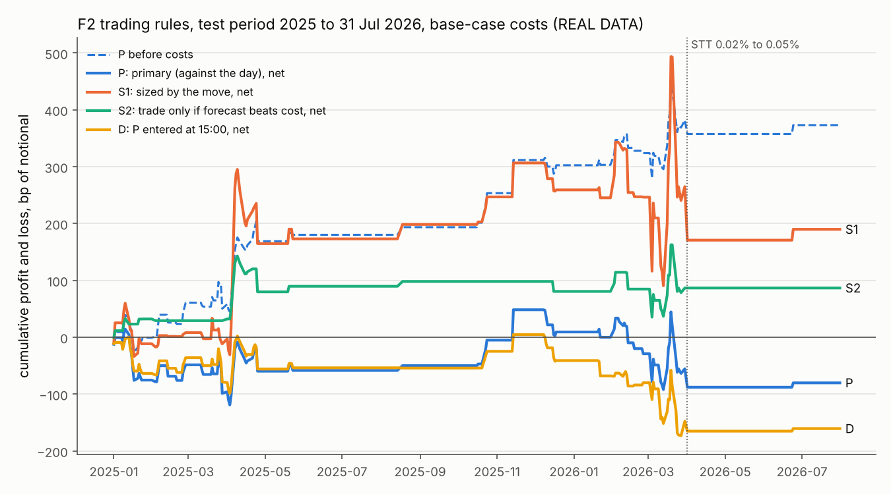
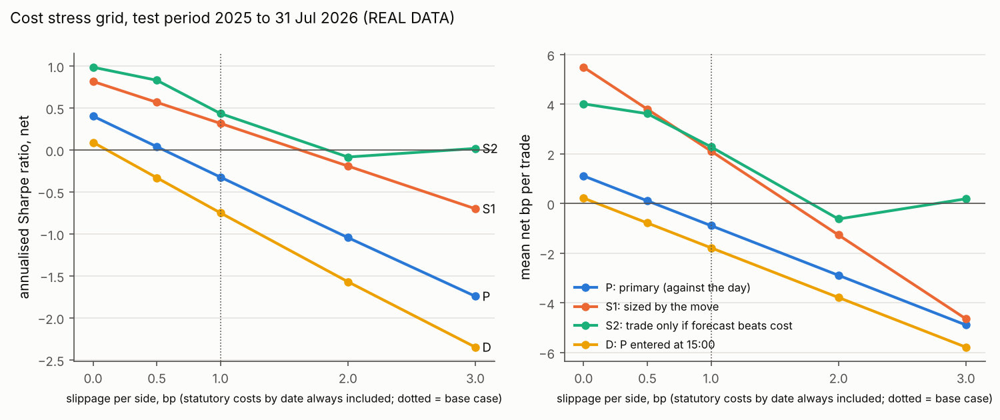

# F2 in money terms: what is left after trading costs? (REAL DATA)

**Everything in this document is REAL DATA**: NSE Nifty 50 1-minute index bars and the NSE participant-wise
open interest behind the "Pro" GEX measure, 2 January 2023 to 2 November 2026. Nothing is simulated except
the unit tests. **This is a research evaluation of the economic size of a statistical finding, not trading
advice.** Nothing here says anyone should trade this rule.

* Pre-registration: `docs/prereg/P90_F2_ECONOMICS.md`, committed as
  **236e3dba89ea8abd6bb6ec275e3e4210460c6dc9** (2 November 2026, 22:36 UTC) before any return data were loaded
  for this study. The rules, samples, costs, metrics, trial count and decision rule below are the ones fixed
  there. Every departure is listed in "Deviations" below.
* Script: `experiments/f2_economics.py`. Unit tests (synthetic data only): `tests/test_f2_economics.py`.
* Outputs: `results/f2_economics/` (tables, two figures, `run_info.json` with seeds and input file hashes) and
  the printed log `results/f2_economics_stdout.txt`.

```
OMP_NUM_THREADS=1 python experiments/f2_economics.py          # about 5 seconds
OMP_NUM_THREADS=1 python -m pytest -q tests/test_f2_economics.py
```

## The answer in short

**Pre-registered verdict: F2 is not economically meaningful (no net edge).** The primary rule, trading against
the day's move into the close after negative-Pro-GEX evenings, made 90 trades in the test period (1 January 2025
to 31 July 2026). After base-case costs it **lost 0.89 bp per trade** on average (0.21 bp per day), with an
annualised **Sharpe ratio of -0.32**, a **Probabilistic Sharpe Ratio of 0.35** and a **Deflated Sharpe Ratio of
about 1e-12**, against the pre-stated bar of 0.95.

1. **The pattern is real before costs, but small.** Before costs the primary rule earned **+4.15 bp per trade**
   in the test period (HAC t 1.90, one-sided p 0.029), more than in 2023 to 2024 (+1.42 bp per trade). F2 is
   still there out of sample, as FALSIFICATION.md found.
2. **Costs are larger than the edge.** A round trip cost 5.04 bp on average for these trades (4.97 bp until
   March 2026, 7.97 bp from April 2026). The **break-even cost is 4.15 bp per round trip**: the rule only breaks
   even if slippage is at most **0.55 bp per side** on top of taxes and fees. The tax on futures sales (STT)
   alone is 2 bp per round trip, and 5 bp since 1 April 2026, which is more than the whole gross edge.
3. **The gross profit rests on a handful of days.** 5 of the 90 trades (7 April 2025, 14 November 2025 and
   three days in March 2026, each with a last-30-minute move of 40 to 87 bp) produced 78% of the gross profit. Without them the
   average gross gain is about 1 bp per trade. (Descriptive, not pre-registered.)
4. **The variants do not rescue it.** Sizing the position by the size of the day's move (S1) and trading only
   when the forecast beats the cost (S2) end up slightly positive after costs (+2.1 and +2.3 bp per trade,
   Sharpe 0.32 and 0.43), but their bootstrap intervals for the Sharpe ratio comfortably include zero and
   their Deflated Sharpe Ratios are below 1e-6. Entering one minute later, at 15:00 (D), makes the primary
   rule worse (-1.78 bp per trade): part of the gross edge sits in the first minute after the signal.

## Words used in this document

* **bp (basis point).** One hundredth of a percent. 10 bp on a position of Rs 15 lakh is Rs 1,500.
* **Notional.** The value of the index exposure a trade carries. All profits and costs are in bp of notional.
* **Round trip.** Opening and closing one position (one buy and one sell order).
* **STT (Securities Transaction Tax).** A tax on the sale side of every futures trade in India. It was raised
  on 1 April 2023, 1 October 2024 and 1 April 2026.
* **Slippage.** The gap between the price used in a backtest and the price a trader actually gets.
* **Gross and net.** Gross is before costs, net is after costs.
* **Hit rate.** The share of trades that made money after costs.
* **Sharpe ratio.** Average daily profit divided by its daily standard deviation (how much it moves around),
  multiplied by the square root of 252 to put it on a yearly scale. Above 1 is usually called good; around 0
  means no reward for the risk taken.
* **Maximum drawdown.** The largest fall of cumulative profit from an earlier high point.
* **HAC t-statistic.** The average profit divided by its standard error, with the standard error allowing for
  correlation between nearby days (Newey-West, 5 lags). Above about 1.65 is "significant at 5%" one-sided.
* **Stationary bootstrap.** Rebuilding many alternative histories by resampling blocks of days at random, to
  see how much the Sharpe ratio could vary by chance. The 95% interval is the middle 95% of those values.
* **Probabilistic Sharpe Ratio (PSR).** The probability that the true Sharpe ratio is above zero, given the
  estimate, the sample length and how unusual (skewed, fat-tailed) the returns are.
* **Deflated Sharpe Ratio (DSR).** The same probability, but measured against the Sharpe ratio that the luckiest
  of N worthless strategies would be expected to show. It corrects for having tried many things.
* **Walk-forward.** Choosing any parameter only from data before the period it is used on, and refitting as
  time moves on.

## What was tested

All of this was fixed in the pre-registration; here is a summary.

* **Signal.** On day t, "negative GEX" means the Pro-rule net GEX at the previous trading day's close was below
  zero (built from NSE files published that evening, so known in the morning). The "rest of day" return is from
  the previous day's 15:29 bar close to today's 14:59 bar close.
* **Primary rule P.** On negative-GEX days, at the 14:59 bar close, sell one unit if the index is up on the
  day and buy one unit if it is down; close at the 15:29 bar close. No trade on other days. No parameters.
* **S1 (sized).** Position = minus the rest-of-day return divided by its typical size on negative-GEX days in
  the training data, capped at 3 units either way.
* **S2 (cost filter).** Trade like P only when R5's regression, fitted on the training data, forecasts a gain
  larger than the round-trip cost on that day.
* **D (sensitivity, not part of the decision).** P entered one minute later, at the 15:00 bar close.
* **Samples.** Training 2023 to 2024 (480 usable days, 365 with negative GEX). Test 1 January 2025 to 31 July
  2026 (389 days, 90 with negative GEX). S1 and S2 are refitted every 21 trading days on all earlier data
  (19 refits, `walkforward_params.csv`). The 63 closing-auction days from 3 August 2026 are reported separately
  because the 15:29 bar is then the auction price, which a futures trader cannot exit at.
* **Instrument.** Index minute bars stand in for near-month Nifty futures. The futures basis, futures quotes
  and liquidity are not modelled; this most likely flatters the rules.
* **Costs per round trip** (bp of notional, rate in force on each date, sources in the pre-registration):

| Period | STT | Exchange charge | SEBI fee | Stamp duty | Brokerage | GST | Slippage (assumption) | Total |
|---|---|---|---|---|---|---|---|---|
| to 31 Mar 2023 | 1.00 | 0.400 | 0.02 | 0.20 | 0.267 | 0.124 | 2.00 | 4.01 |
| 1 Apr 2023 to 30 Sep 2024 | 1.25 | 0.400 | 0.02 | 0.20 | 0.267 | 0.124 | 2.00 | 4.26 |
| 1 Oct 2024 to 31 Mar 2026 | 2.00 | 0.366 | 0.02 | 0.20 | 0.267 | 0.117 | 2.00 | 4.97 |
| from 1 Apr 2026 | 5.00 | 0.366 | 0.02 | 0.20 | 0.267 | 0.117 | 2.00 | 7.97 |

Brokerage is Rs 20 per order, converted at a notional of Rs 15 lakh. Slippage is 1 bp per side in the base case
and 0, 0.5, 2 and 3 bp per side in the stress grid. Source: `results/f2_economics/cost_schedule.csv`.

Before computing anything, the script re-estimated R5's Pro interaction from the same files: -0.0681961821
(n 929), identical to `results/momentum_gex/regressions.csv` (difference 1e-17).

## Results (REAL DATA)

**Table 1. Test period (1 Jan 2025 to 31 Jul 2026), base-case costs, profit and loss.** bp of notional. Per-day
figures count flat days as 0, so the median per day is 0 for every rule (most days have no trade).

| Rule | Trades | Gross per trade | Cost per trade | Net per trade, mean | Net per trade, median | Net per day, mean | Hit rate |
|---|---|---|---|---|---|---|---|
| **P (primary)** | 90 | 4.15 | 5.04 | **-0.89** | -3.54 | -0.21 | 45.6% |
| S1 (sized) | 90 | 10.68 | 8.57 | 2.11 | -0.68 | 0.49 | 45.6% |
| S2 (cost filter) | 38 | 7.25 | 4.97 | 2.28 | 4.17 | 0.22 | 57.9% |
| D (15:00 entry) | 90 | 3.25 | 5.04 | -1.78 | -1.67 | -0.41 | 41.1% |

S1's per-trade figures are larger because its positions average 1.7 units; per unit traded its break-even cost
is 6.33 bp (Table 2).

**Table 2. Test period, base-case costs, risk and inference.**

| Rule | Sharpe (annualised) | 95% bootstrap interval | HAC t (one-sided p) | Max drawdown, bp (days, dates) | Break-even cost per round trip | Break-even slippage per side | PSR(0) | DSR (N = 824) |
|---|---|---|---|---|---|---|---|---|
| **P** | **-0.32** | -1.89 to 1.10 | -0.41 (0.66) | 140 (81, 14 Nov 2025 to 13 Mar 2026) | **4.15** | 0.55 | **0.35** | **1.4e-12** |
| S1 | 0.32 | -1.21 to 1.62 | 0.41 (0.34) | 323 (7, 19 Mar to 1 Apr 2026) | 6.33 | 1.62 | 0.66 | 6.7e-11 |
| S2 | 0.43 | -1.05 to 1.75 | 0.58 (0.28) | 107 (221, 9 Apr 2025 to 4 Mar 2026) | 7.25 | 2.14 | 0.71 | 1.7e-10 |
| D | -0.75 | -2.27 to 0.63 | -1.02 (0.85) | 178 (90, 14 Nov 2025 to 27 Mar 2026) | 3.25 | 0.11 | 0.19 | 1.6e-13 |

Bootstrap: stationary, mean block 5 days, 10,000 resamples, seeds `[20261102, 90, k]` with k = 0 to 3. For S2
the break-even cost holds its base-case trades fixed. The daily net returns are strongly skewed and fat-tailed
(kurtosis 24 to 47), which the PSR and DSR take into account.

Sources: `results/f2_economics/metrics.csv`, `bootstrap_sharpe.csv`, `daily_pnl.csv`, `trades.csv`.

**Table 3. Cost stress grid, test period: annualised Sharpe ratio (mean net bp per trade).** Statutory costs
by date are always included except in the "gross" column.

| Rule | Gross | Slippage 0 | 0.5 bp | 1 bp (base) | 2 bp | 3 bp |
|---|---|---|---|---|---|---|
| P | 1.49 (+4.15) | 0.40 (+1.11) | 0.04 (+0.11) | -0.32 (-0.89) | -1.04 (-2.89) | -1.74 (-4.89) |
| S1 | 1.56 (+10.68) | 0.82 (+5.49) | 0.57 (+3.80) | 0.32 (+2.11) | -0.19 (-1.27) | -0.70 (-4.64) |
| S2 | 1.43 (+4.63) | 0.99 (+4.01) | 0.83 (+3.62) | 0.43 (+2.28) | -0.08 (-0.62) | 0.02 (+0.19) |
| D | 1.36 (+3.25) | 0.09 (+0.22) | -0.33 (-0.78) | -0.75 (-1.78) | -1.57 (-3.78) | -2.35 (-5.78) |

S2 trades less as costs rise (74 trades gross, 54 at zero slippage, 38 at the base case, 15 at 3 bp), as
pre-registered. Even with zero slippage and only taxes and fees, no rule has a HAC t above 1.27. Source:
`results/f2_economics/cost_grid.csv`.



*Figure 1. Cumulative profit and loss in bp of notional, test period, base-case costs (REAL DATA). The dashed
line is rule P before costs. The flat stretches are periods with no negative-GEX evenings; the dotted line
marks the STT increase of 1 April 2026.*



*Figure 2. Annualised Sharpe ratio (left) and mean net bp per trade (right) as slippage per side rises, test
period (REAL DATA). The dotted line is the base case.*

**Table 4. Deflated Sharpe Ratio.** The 82 trial t-statistics (78 from FALSIFICATION family A and the 4 rules
here) put on the test period's scale give V = 0.0112, i.e. a spread of 2.09 in the trials' t-statistics.
Source: `results/f2_economics/dsr.csv`.

| Trials N | Multiplier of sqrt(V) | Sharpe the luckiest worthless trial would show (annualised) | DSR of P | Highest DSR of any rule |
|---|---|---|---|---|
| 82 (family A and this study) | 2.46 | 4.14 | 2.3e-8 | 1.3e-6 (S2) |
| **824 (pre-registered)** | **3.20** | **5.38** | **1.4e-12** | 1.7e-10 (S2) |
| 3,624 (adding the T3 placebo sign rules) | 3.60 | 6.06 | 2.6e-15 | 4.3e-13 (S2) |

The hurdle is high because the project's 78 original GEX tests include several large t-statistics. It does not
drive the verdict: even if V were set to its pure-noise value 1/T, the hurdle at N = 824 would be an annualised
Sharpe ratio of about 2.6 (3.20 x sqrt(252 / 389)), and the primary rule's Sharpe ratio is negative.

**Table 5. Context only (not part of the decision), base-case costs.**

| Sample | Rule | Trades | Gross per trade | Net per trade | Sharpe (annualised) |
|---|---|---|---|---|---|
| Training 2023 to 2024 (in sample) | P | 365 | 1.42 | -2.90 | -2.13 |
| | S1 | 365 | 3.97 | -1.07 | -0.42 |
| | S2 | 88 | 6.25 | 1.95 | 0.55 |
| | D | 365 | 1.52 | -2.79 | -2.42 |
| Closing-auction days, 3 Aug to 2 Nov 2026 (not tradable as measured) | P | 8 | 10.26 | 2.29 | 0.71 |
| | S1 | 8 | 4.99 | -4.65 | -0.83 |
| | S2 | 0 | | | |
| | D | 8 | 9.60 | 1.63 | 0.48 |

In 2023 to 2024, S1 and S2 use parameters fitted on that same period, so those rows see the future by
construction. Eight auction-day trades are far too few to say anything. Within the test period, rule P gained
+0.16 bp per trade net in 2025 (59 trades) and lost 2.89 bp per trade net in 2026 (31 trades; descriptive).
Sources: `metrics.csv`, `auction_days.csv`, `trades.csv`.

## Pre-registered verdict

The decision rule fixed before the run: rule P, test period, base-case costs, daily series, N = 824 trials;
"economically meaningful" if DSR > 0.95. **DSR = 1.4e-12, so F2 is not economically meaningful.** Because the
mean net return per day is below zero (-0.21 bp; the break-even cost of 4.15 bp is below the base-case cost of
about 5 bp), the pre-stated description is **"no net edge"**. None of S1, S2 or D has a DSR above 0.95, so none
counts as a lead for a new test either.

What this means in plain words: F2 is a real statistical regularity (it held up in every falsification test and
is still visible before costs in 2025 to 2026), but it is worth about 4 bp per trade on roughly one day in four,
and taxes, fees and a modest allowance for slippage take all of that and a little more. The test has low power
(90 trades), so "not meaningful" means "not shown to be meaningful"; the break-even cost and the stress grid
measure the size directly, and they say the same thing.

## Deviations from the pre-registration

**None in the rules, samples, costs, metrics, trial count, seeds or decision rule.** Points where the
pre-registration was silent, and what was done:

1. **First days of 2023.** The first usable day is 3 January 2023 (2 January has no previous close in the
   minute bars). GEX is treated as missing, so no trade, on 3 to 5 January 2023, because R5's GEX series is
   divided by a 20-day median of gross GEX that needs 5 days of history. This is R5's own coding (929 days);
   it affects only the training period.
2. **Parameters for the context samples.** For the 2023 to 2024 table, S1 and S2 use parameters fitted on all
   of 2023 to 2024; for the auction-day table, on all days before 3 August 2026. Neither enters the decision.
3. **Drawdown length** is counted in trading days from the peak to the trough.
4. **Cost rates were not re-checked at the source.** The network block on nseindia.com and zerodha.com
   persisted, so the pre-registered rates were used unchanged (as the pre-registration requires).

Additions not in the pre-registration, none of which enters the decision: the two figures (requested
afterwards), the note on how concentrated the gross profit is, the split of rule P by calendar year, and the
arithmetic remark on V = 1/T under Table 4.

## Limitations

* **Index, not futures.** The futures basis, the futures bid-ask spread and the lead of futures over the index
  are not modelled. Bar closes are single trades, not guaranteed prices. These most likely make the results
  look better than real trading would, which strengthens the negative verdict.
* **Slippage is an assumption.** No published bid-ask spread for Nifty futures was found. The stress grid shows
  that the primary rule is negative above 0.55 bp per side.
* **Few trades.** Negative Pro GEX was common in 2023 to 2024 (365 of 480 days) and rare afterwards (90 of 389),
  so the test period has only 90 trades, and 2 of them after the April 2026 STT increase.
* **The test period is not unseen.** R5 was found on the full sample including 2025 and 2026; the Deflated
  Sharpe Ratio is the correction for that, and it is far from the bar in any case.
* **Costs for one trader.** Brokerage is converted at Rs 15 lakh; a larger trader pays less brokerage per bp
  but more market impact. Brokerage is 0.27 bp of the roughly 5 bp total, so this does not matter here.

## Files

* `experiments/f2_economics.py`: the script.
* `tests/test_f2_economics.py`: 20 unit tests on synthetic data (PSR and DSR against hand-worked values, cost
  schedule by date, no look-ahead in the walk-forward, positions that ignore the same day's outcome, HAC t
  against statsmodels, drawdown, bootstrap, break-even cost).
* `results/f2_economics/`: `cost_schedule.csv`, `walkforward_params.csv`, `metrics.csv` (all samples and
  rules), `bootstrap_sharpe.csv`, `dsr.csv`, `cost_grid.csv`, `daily_pnl.csv` (test period, every day and rule),
  `trades.csv` (every trade with each cost component), `auction_days.csv`, `fig_equity_curve.png`,
  `fig_cost_grid.png`, `run_info.json` (pre-registration commit, seeds, trial count, V, first 16 hex digits of
  the SHA-256 of each input file, package versions).
* `results/f2_economics_stdout.txt`: the printed log.
