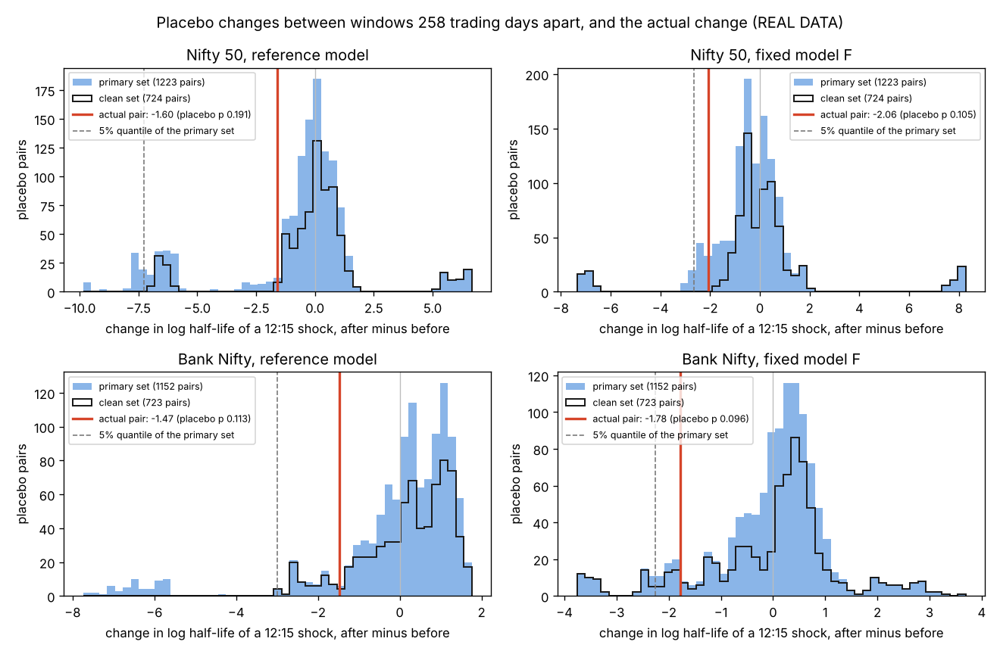

# P117: is the fall in intraday persistence larger than in comparable windows without the expiry change?

Study P117, run by an AI agent (Claude) working for Shreyan Thanki on 3 November 2026.
**All numbers below are REAL DATA** (Nifty 50, Bank Nifty and Nifty Financial Services (Fin Nifty) one-minute index
data, with the replication's data steps) unless marked SYNTHETIC. Every number comes from a file in
`results/p117_persistence_placebo/` (file named next to each table) or, where marked, from P114's committed results.

* Registered plan: `docs/prereg/P117_PERSISTENCE_PLACEBO.md`, commit `27d39ba417c884dc9605dc9ddf6c1756cf17f380`
  (committed 11:37:55 UTC and pushed before any placebo window, any Fin Nifty model or any test statistic of this
  study was computed on real data).
* Code: `experiments/p117_persistence_placebo.py` (in the plan commit; the run used that commit's code; one log line
  was later rewritten for Python 3.11, with no change to any computation, Section 11). No shared code in
  `src/niftygex/` was changed or added. Tests (SYNTHETIC only): `tests/test_p117_persistence_placebo.py`. One
  **post hoc** script was added after the Nifty results were seen (`experiments/p117_posthoc_flat_days.py`,
  descriptive only, no p-values; Section 7).
* Every p-value of the study: `results/p117_persistence_placebo/tests.csv` (26 rows: 2 primary, 22 secondary, 2
  exploratory).

Words used below.

* **Half-life**: how many trading minutes it takes for the extra volatility caused by one surprise move (a shock at
  12:15) to fall to half of its first effect. Long half-life = shocks linger; short = they die out fast. It is P114's
  primary measure; for the reference model it is ln(0.5) / ln(alpha + beta), the paper's half-life.
* **Reference model**: the replication's mcsGARCH, as in its Table 2. **Fixed model F**: P114's model with three of
  P109's fixes (a HAR daily level, an overnight fade of the intraday part, and today's running mean).
* **Change**: ln(half-life after) minus ln(half-life before), in "log points". Negative = a fall. A change of -1.6 is
  a fivefold fall (exp(1.6) = 4.95); -2.1 is about eightfold.
* **Actual pair**: the inferred before window (14 November 2022 to 10 February 2023, 64 trading days) and the after
  window (1 March to 31 May 2024, 59 days), as in P114. There are 258 trading days between them.
* **Placebo pair**: any other pair of windows with the same lengths and the same 258-day gap, starting on any
  trading day from 2018 to 2025. A pair **straddles** a calendar change if the change happened after the first day
  of its before window and on or before the last day of its after window.
* **Placebo sets**: **primary** = pairs that straddle neither of the two Bank Nifty expiry moves that lie between the
  actual windows (event a, the weekly move from Thursday to Wednesday in September 2023, and event b, CPP's monthly
  move in March 2024); **clean** = pairs that straddle no Nifty or Bank Nifty calendar change at all; **literal** =
  pairs that do not straddle event b.
* **Placebo p**: (1 + placebo pairs whose change is at or below the actual change) / (1 + placebo pairs). A small p
  means that falls as large as the actual one are rare among the placebo pairs.
* **Day-disjoint pairs**: placebo pairs that share no trading day with each other. Neighbouring placebo pairs share
  most of their days, so the number of day-disjoint pairs shows how much independent information there really is.
* **DiD** (difference-in-differences): the treated index's change minus Fin Nifty's change over the same days.
  Fin Nifty's expiry calendar did not change between the windows. Negative = the treated index fell more.
* **Holm**: an adjustment that raises p-values when several tests are made together.

## 1. The answer in plain words (REAL DATA)

The anchor paper (Chhimwal, Pandey and Pandey 2025, "CPP") reports that after Bank Nifty's monthly expiry day moved
(March 2024), a burst of intraday volatility dies out much faster. Our replication finds the same with the paper's
model, and P114 found that, for Nifty, the fall also survives a better model: the half-life of a shock at 12:15
falls from 141 to 18 minutes. But P114 also found that the before window (14 November 2022 to 10 February 2023) is
the most persistent of 44 rolling Nifty windows since November 2022, so the fall could be a return from an
unusually persistent period that would have happened anyway. This study compared the actual fall with (a) the
changes between every other pair of windows with the same lengths and spacing from 2018 to 2026 that do not
straddle the two Bank Nifty expiry moves (placebo pairs), and (b) the change in Fin Nifty, whose expiry calendar did
not change, over the same days.

**Is the fall larger than in comparable windows without the expiry change? No. For Nifty, under both models, the
registered verdict is "the fall is within the normal range".**

* Under the fixed model F, the Nifty half-life falls from **141 to 17.9 minutes** (a change of -2.06 log points, an
  eightfold fall). **128 of the 1,223 placebo pairs (10.5%) fell at least as far**: placebo p 0.105, Holm p 0.211.
* Under the reference model (the paper's mcsGARCH), it falls from **359 to 72 minutes** (-1.60, fivefold); **233 of
  1,223 placebo pairs (19.1%)** fell at least as far: p 0.191, Holm p 0.211.
* **Bank Nifty**, the index whose calendar changed, gives the same answer (secondary family S1): F 62.2 to 10.5
  minutes, 110 of 1,152 placebo pairs (9.5%) at least as far, p 0.096; reference 164.9 to 37.9 minutes, 129 of
  1,152 (11.2%), p 0.113; Holm p 0.193 for both: "the fall is within the normal range".
* The other registered versions of the placebo test agree (the literal set, which only leaves out pairs that
  straddle CPP's event; and the count of day-disjoint pairs). The clean set (pairs that straddle no calendar change
  at all) gives no verdict, as fixed in advance, because it holds only 1 to 2 separate periods; its raw p-values are
  0.057 to 0.120.

**An index whose calendar did not change fell just as much.** Over the same days, Fin Nifty's half-life fell from
72.4 to 9.3 minutes under F (-2.05 log points, the same as Nifty's -2.06) and from 175.1 to 43.6 minutes under the
reference (-1.39). The difference-in-differences is close to zero in all four comparisons (Nifty and Bank Nifty,
both models: -0.21 to +0.26 log points), and the registered verdict for each is **"the fall is not clearly larger
than the control's"** (Holm p 1.000). The bootstrap intervals of the DiD are wide (for Nifty under F, -1.78 to
+1.89), so the data also cannot rule out a sizeable difference in either direction.

**Why: the before window was the unusual one, not the after window.** Under F, the Nifty before window is more
persistent than 94.8% of the placebo before windows (Bank Nifty: 99.3%), while the after windows are ordinary
(19.4th and 13.5th percentiles). Given how persistent the before window was, the after window is not unusually short
(the conditional placebo, S5: p 0.204 for Nifty and 0.311 for Bank Nifty under F). One secondary result points the
other way: under the reference model, Bank Nifty's after window is unusually short given its before window (S5,
p 0.012, Holm p 0.049, "the fall is unusual"). The fixed model does not confirm it, and the plan reads a result
that only the reference model shows as depending on that model's known flaw (Section 5).

**A closer look (post hoc, descriptive, Section 7).** For Nifty, the placebo falls as large as the actual one come
from two places. Some come from a data defect: on 24 February 2021 an outage halted trading at NSE and the Nifty
minute file is flat for most of the day, which pushes most windows containing that day to the models'
persistence limit. The rest are pairs that lie entirely after CPP's event, comparing 2024 to 2025 with 2025 to
2026, over which persistence kept falling (under F, the median half-life of these pairs went from 46.7 to 8.3
minutes). Among Nifty pairs from 2018 to 2023 without the defective day, none fell as far as the actual pair under
F; but these pairs overlap heavily (the clean set among them holds on average only 5.3 pairs that share no trading
day). For Bank Nifty there is no such defect, and falls as large as the actual one did occur in calendar-stable
years (86 of 723 clean pairs under F, with before windows in 2020 and 2021).

**What it means.** The fall in persistence that CPP attribute to the expiry change is real in the point estimates,
but it is no evidence that the change caused it. Falls of this size between windows this far apart happen in one
placebo pair in ten to one in five; the fall is mostly a return from an unusually persistent end of 2022; persistence kept falling
after 2024; and Fin Nifty, whose expiry did not move, fell as much over the same days. The study cannot rule out
that the expiry change had some effect (one event, few independent periods, wide DiD intervals, a control that
shares stocks with Bank Nifty), but the evidence cannot separate such an effect from ordinary drift in persistence
(Section 13).

## 2. What was registered (in short)

* **Statistic.** For a pair of windows and a model: the change = ln(half-life after) - ln(half-life before), with
  half-lives capped at 100,000 minutes (P114's cap). Two models, each fitted exactly as in P114: the reference and F.
* **The actual pair** is fitted by the same code and on the same grid as the placebo pairs: each index's own grid
  (days with at least 300 one-minute bars from 09:15 to 15:14), daily levels fitted on all data up to each window's
  last day. P114's numbers (on the replication's two-index grid) are shown next to it.
* **Placebo pairs.** Every start day with at least 250 trading days of data before it (so the daily models see at
  least a year), one-day steps: the before window is 64 days from the start, the after window 59 days starting 322
  days after the start (64 + 258). Data end: Nifty 2 November 2026, Bank Nifty 22 April 2026.
* **Calendar changes** (from the project's event table): Nifty weekly options (4 March 2019, the event study's
  long-sample start), a (25 August 2023), **b, CPP's event (1 March 2024)**, c (14 November 2024, Bank Nifty weekly
  options stop), c2 (25 December 2024, Bank Nifty monthly to last Thursday), d (22 August 2025, Nifty weekly to
  Tuesday and both monthlies to Tuesday), e (3 August 2026, closing auction). Each date is the first day on which
  the old schedule no longer applied.
* **Sets.** Primary: no a and no b (the two changes inside the actual pair). Clean: no change at all. Literal: no b.
  The primary set was chosen in advance because the clean set, with pairs 381 days long, holds only 1 to 2 wholly
  separate periods (plan Section 3).
* **Placebo p** = (1 + pairs at or below the actual change) / (1 + pairs), one-sided. **Overlap** is handled by (1)
  a conservative p that counts only day-disjoint pairs (S4), (2) a **minimum for a verdict: at least 200 pairs and on
  average at least 8 day-disjoint pairs**, and (3) the number of wholly separate periods, reported with every set.
* **Decision rule** (each model separately, on the Holm-adjusted p of the primary family of 2 tests): **"the fall is
  unusual"** if at most 0.05; **"unclear"** if above 0.05 and at most 0.10; **"the fall is within the normal range"**
  if above 0.10; "no verdict" if the set misses the minimum.
* **Secondary families** (Holm within each): S1 Bank Nifty, primary set (2 tests); S2 the clean set (4); S3 the
  literal set (4); S4 the day-disjoint p (4); S5 the conditional placebo, which asks whether the after window is
  unusually short given how persistent the before window was (4); D the difference-in-differences against Fin
  Nifty (4). Exploratory E1: Fin Nifty's own change (2).
* **Difference-in-differences.** DiD = change (Nifty or Bank Nifty) - change (Fin Nifty) over the actual windows
  (the same 64 + 59 dates). Inference: P114's committed day-block bootstrap draws for the treated index (400 per
  window), and Fin Nifty refitted on the same resampled days (the treated index's seeds). Rule on the Holm p: at
  most 0.05 "the fall is larger than the control's", above 0.10 "not clearly larger", between "unclear".
* **What we expected** (stated in the plan, not a rule): the reference "within the normal range"; F "unclear" or
  "unusual" unconditionally but "within the normal range" given the before window (S5); Fin Nifty's half-life also
  fell (D "not clearly larger").

## 3. The primary result (REAL DATA, Nifty, primary set)

**The actual pair** (`placebo_summary.csv`; P114's numbers on the replication's two-index grid from
`control_fits.csv`, which refits them identically to `results/p114_persistence_fixed_model/fits.csv`):

| Model | Half-life before (minutes) | Half-life after (minutes) | Change (log points) | Fall factor | P114, two-index grid |
|---|---|---|---|---|---|
| Reference (mcsGARCH) | 359.04 | 72.36 | -1.602 | 4.96 | 358.64 to 72.44 |
| Fixed model F | 141.03 | 17.91 | -2.064 | 7.87 | 141.05 to 17.91 |

The one-index grid that the placebo pairs need gives the same Nifty half-lives as P114's grid to within 0.2%.

**The placebo test** (family P; `tests.csv`, `verdict.csv`, `placebo_summary.csv`). 1,223 placebo pairs, with before
windows starting from 9 April 2018 to 17 April 2025 and the last after window ending on 2 November 2026; no pair was
dropped (every window fit converged).

| Model | Placebo pairs | Pairs with a change at or below the actual | Share | Placebo p | Holm p (2 tests) | Verdict |
|---|---|---|---|---|---|---|
| Reference | 1,223 | 233 | 19.1% | 0.191 | 0.211 | **the fall is within the normal range** |
| Fixed model F | 1,223 | 128 | 10.5% | 0.105 | 0.211 | **the fall is within the normal range** |

The set meets the registered minimum: 1,223 pairs (at least 200) and on average 12.4 day-disjoint pairs per phase
(10 to 15; at least 8 needed), with 3 to 4 wholly separate 381-day spans.

**The placebo distribution** (quantiles of the change in log points, primary set, `placebo_summary.csv`):

| Model | 1% | 5% | 10% | 25% | median | 75% | 90% | 95% | 99% | Pairs with a fall |
|---|---|---|---|---|---|---|---|---|---|---|
| Reference | -8.01 | -7.27 | -6.42 | -1.06 | -0.13 | +0.54 | +1.09 | +1.72 | +6.47 | 55.4% |
| Fixed model F | -7.08 | -2.65 | -2.10 | -0.89 | -0.34 | +0.35 | +0.93 | +1.62 | +8.03 | 60.2% |



*Figure (`fig_placebo.png`, REAL DATA): the changes in log half-life between the placebo pairs of the primary set
(blue bars) and of the clean set (black outline), with the actual change (red line) and the primary set's 5%
quantile (grey dashed line); Nifty on top, Bank Nifty below.* For Nifty, the bulk of the placebo changes lies
between about -2.5 and +2.5 log points. The small clusters near -7 and near +6 to +8 are pairs with one window that
contains 24 February 2021, a day on which trading halted and the minute file is flat (Section 7); under the
reference a second cluster near -6 to -8 comes from before windows in 2024 and 2025 at the model's persistence
bound. Under F the actual change sits at about the 10% point of the placebo changes; under the reference at about
the 19% point. `fig_placebo_time.png` plots every placebo change against the first day of its before window.

## 4. Was it the before window or the after window? (REAL DATA, Nifty, primary set)

The ranks of the actual windows among the placebo windows (`placebo_summary.csv`, `rank_before_actual_pct` and
`rank_after_actual_pct`: the share of placebo before or after windows with a half-life at or below the actual one):

| Model | Before window (14 Nov 2022 to 10 Feb 2023) | After window (1 Mar to 31 May 2024) |
|---|---|---|
| Reference | 75.7th percentile | 13.7th percentile |
| Fixed model F | 94.8th percentile | 19.4th percentile |

Under F the before window is more persistent than 94.8% of the placebo before windows, while the after window is an
ordinary, somewhat short one. The conditional placebo (S5) asks whether the after window is unusually short given
how persistent the before window was. Across the placebo pairs, a regression of the change on the before window's
log half-life has a slope close to -1 (-1.19 for the reference, -1.02 for F): the after window's half-life barely
depends on the before window's, so a high start is, on average, followed by an ordinary level and a large fall.
Given its before window, the actual pair's change is 0.95 log points (reference) and 0.71 log points (F) lower than
this regression predicts, but residuals that low are common (`tests.csv`, `placebo_summary.csv`):

| Model | Slope | Actual residual | SD of the placebo residuals | Placebo residuals at or below | p | Holm p (S5, 4 tests) | Label |
|---|---|---|---|---|---|---|---|
| Reference | -1.190 | -0.949 | 1.469 | 173 of 1,223 | 0.142 | 0.426 | within the normal range |
| Fixed model F | -1.019 | -0.712 | 1.617 | 249 of 1,223 | 0.204 | 0.426 | within the normal range |

So the fall is about what usually follows a before window as persistent as this one. This is the pattern we
expected (Section 8), and it extends P114's finding that, under F, the before window is the outlier, from 2022 to
2026 back to 2018.

## 5. Bank Nifty and the other registered versions (REAL DATA)

**Bank Nifty's actual pair** (`placebo_summary.csv`; P114's two-index grid from `control_fits.csv`):

| Model | Half-life before (minutes) | Half-life after (minutes) | Change (log points) | Fall factor | P114, two-index grid |
|---|---|---|---|---|---|
| Reference | 164.88 | 37.91 | -1.470 | 4.35 | 161.97 to 37.96 |
| Fixed model F | 62.18 | 10.47 | -1.781 | 5.94 | 62.66 to 10.47 |

Bank Nifty's one-index grid keeps days that the two-index grid drops (it starts in January 2017, three months
before Nifty's data), so its daily models see a slightly different history; the before half-lives differ by up to
1.8% (reference).

**Every placebo test** (`tests.csv`, `verdict.csv`; Holm within each family; the label is the registered rule
applied to the Holm p):

| Test | Index | Set or method | Model | Pairs | Actual change or residual | p | Holm p | Label |
|---|---|---|---|---|---|---|---|---|
| P | Nifty | primary | reference | 1,223 | -1.602 | 0.191 | 0.211 | within the normal range |
| P | Nifty | primary | F | 1,223 | -2.064 | 0.105 | 0.211 | within the normal range |
| S1 | Bank Nifty | primary | reference | 1,152 | -1.470 | 0.113 | 0.193 | within the normal range |
| S1 | Bank Nifty | primary | F | 1,152 | -1.781 | 0.096 | 0.193 | within the normal range |
| S2 | Nifty | clean | reference | 724 | -1.602 | 0.095 | 0.273 | no verdict (too few separate periods) |
| S2 | Nifty | clean | F | 724 | -2.064 | 0.057 | 0.226 | no verdict |
| S2 | Bank Nifty | clean | reference | 723 | -1.470 | 0.091 | 0.273 | no verdict |
| S2 | Bank Nifty | clean | F | 723 | -1.781 | 0.120 | 0.273 | no verdict |
| S3 | Nifty | literal | reference | 1,350 | -1.602 | 0.173 | 0.403 | within the normal range |
| S3 | Nifty | literal | F | 1,350 | -2.064 | 0.101 | 0.403 | within the normal range |
| S3 | Bank Nifty | literal | reference | 1,279 | -1.470 | 0.128 | 0.403 | within the normal range |
| S3 | Bank Nifty | literal | F | 1,279 | -1.781 | 0.146 | 0.403 | within the normal range |
| S4 | Nifty | primary, day-disjoint pairs only | reference | 12.4 per phase | -1.602 | 0.395 | 0.583 | within the normal range |
| S4 | Nifty | primary, day-disjoint pairs only | F | 12.4 per phase | -2.064 | 0.160 | 0.583 | within the normal range |
| S4 | Bank Nifty | primary, day-disjoint pairs only | reference | 11.2 per phase | -1.470 | 0.233 | 0.583 | within the normal range |
| S4 | Bank Nifty | primary, day-disjoint pairs only | F | 11.2 per phase | -1.781 | 0.146 | 0.583 | within the normal range |
| S5 | Nifty | primary, given the before window | reference | 1,223 | residual -0.949 | 0.142 | 0.426 | within the normal range |
| S5 | Nifty | primary, given the before window | F | 1,223 | residual -0.712 | 0.204 | 0.426 | within the normal range |
| S5 | Bank Nifty | primary, given the before window | reference | 1,152 | residual -1.356 | 0.012 | **0.049** | **the fall is unusual** |
| S5 | Bank Nifty | primary, given the before window | F | 1,152 | residual -0.212 | 0.311 | 0.426 | within the normal range |

Notes on reading the table:

* **The clean set** (S2) gives no verdict because it misses the registered minimum: 724 Nifty and 723 Bank Nifty
  pairs, but on average only 5.3 day-disjoint pairs and 1 to 2 wholly separate spans (all its pairs lie between
  March 2019 and August 2023). Its p-values are a little lower than the primary set's for Nifty (0.057 for F) and a
  little higher for Bank Nifty under F (0.120).
* **The day-disjoint p** (S4) cannot fall below 0.076 (Nifty) or 0.083 (Bank Nifty) with so few separate pairs; as
  the plan said, it can confirm "within the normal range" but could never show "unusual".
* **Bank Nifty's distributions** (`placebo_summary.csv`, primary set): under F the quantiles are -3.36 (2.5%), -2.26
  (5%), -1.69 (10%), +0.18 (median) and +1.56 (95%), and 40.7% of pairs show a fall; under the reference -6.34,
  -2.99, -1.76, +0.31 and +1.43, with 35.9% showing a fall. The actual Bank Nifty before window ranks at the 69.3rd
  (reference) and 99.3rd (F) percentile of the placebo before windows, and the after window at the 1.5th (reference)
  and 13.5th (F) percentile of the placebo after windows.
* **The one "unusual" row (S5, Bank Nifty, reference).** Under the reference, Bank Nifty's after window (37.9
  minutes) is shorter than about 98.5% of placebo after windows, while its before window is ordinary (69.3rd
  percentile), so given the before window the fall is larger than the placebo pairs predict (13 of 1,152 placebo
  residuals are at or below; Holm p 0.049, just under 0.05). Under F the same comparison is ordinary (residual
  -0.21, p 0.311), because F finds the before window, not the after window, to be extreme. The plan's reading for
  the primary family ("the reference unusual but F not: the unusual size depends on the misspecified model") fits
  here too: P109 and P114 showed that the reference model lacks a moving intraday level and that its half-lives
  move with the day-level drift. Also, 56 Bank Nifty before windows of the reference (starting from 11 March to 4
  June 2024) sit at the persistence bound (`posthoc_bound_windows.csv`), and they enter the regression that S5
  uses. This row is secondary and does not change any primary verdict.

## 6. The difference-in-differences against Fin Nifty (REAL DATA, family D and exploratory E1)

`did.csv`, `control_fits.csv`, `control_bootstrap_draws.csv`, `tests.csv`. The treated indices use the
replication's two-index grid (P114's fits and P114's committed bootstrap draws); Fin Nifty uses its own grid on
exactly the same dates, refitted on the same resampled days. 400 bootstrap draws for each, none failed.

**Half-lives on the actual windows (minutes):**

| Index | Reference before | Reference after | Change | F before | F after | Change |
|---|---|---|---|---|---|---|
| Nifty | 358.64 | 72.44 | -1.600 | 141.05 | 17.91 | -2.064 |
| Bank Nifty | 161.97 | 37.96 | -1.451 | 62.66 | 10.47 | -1.789 |
| **Fin Nifty (control)** | 175.13 | 43.57 | -1.391 | 72.37 | 9.29 | -2.053 |

**The DiD** (treated change minus Fin Nifty's change; 95% bootstrap interval; one-sided p for "the treated index
fell more"):

| Treated | Model | DiD | 95% interval | Draws with DiD below 0 | p | Holm p (4 tests) | Label |
|---|---|---|---|---|---|---|---|
| Nifty | reference | -0.208 | -1.627 to +1.240 | 56.5% | 0.436 | 1.000 | the fall is not clearly larger than the control's |
| Nifty | F | -0.010 | -1.784 to +1.886 | 41.0% | 0.591 | 1.000 | the fall is not clearly larger than the control's |
| Bank Nifty | reference | -0.060 | -1.243 to +1.084 | 60.8% | 0.394 | 1.000 | the fall is not clearly larger than the control's |
| Bank Nifty | F | +0.264 | -0.965 to +1.484 | 32.3% | 0.678 | 1.000 | the fall is not clearly larger than the control's |

**Fin Nifty's own change** (exploratory E1, no adjustment; resampled on Nifty's days): under F -2.053 log points,
95% interval -3.420 to +0.317, 95.5% of draws show a fall, p 0.047; under the reference -1.391, interval -2.648 to
+0.433, 93.0% of draws fall, p 0.072. Resampled on Bank Nifty's days instead (descriptive, `did.csv`): p 0.060 (F)
and 0.077 (reference).

In words: over the same days, Fin Nifty's half-life fell about as much as Nifty's and Bank Nifty's (under F, by a
factor of 7.8 against Nifty's 7.9 and Bank Nifty's 6.0). The point estimates of the DiD are close to zero, and Bank
Nifty under F fell slightly less than the control. This is what the plan expected ("Fin Nifty's half-life also
fell"). The intervals are wide, though: their lower ends lie between -0.97 and -1.78 log points and their upper
ends between +1.08 and +1.89, so a treated-specific difference of several-fold, in either direction, is also
consistent with the data. The DiD gives no sign that the fall is specific to the indices tied to the change; it
cannot show that there was no specific effect.

## 7. Where the large placebo falls come from (post hoc, descriptive, REAL DATA)

Everything in this section was decided after the Nifty results were seen. It adds no p-value to `tests.csv` and
changes no registered number or verdict (`experiments/p117_posthoc_flat_days.py`; files `posthoc_*.csv`).

**A data defect.** The Nifty placebo distributions have clusters far from the bulk (near -7 and near +6 to +8 log
points). All of the far rises and, under F, all of the far falls come from one day (under the reference, before
windows of 2024 and 2025 at the persistence bound add more far falls). On 24 February 2021 a technical failure at
NSE halted trading; the Nifty minute file repeats the last price for most of the day, 288 flat bars (minutes with no
price change) out of 360 (`posthoc_flat_days.csv`). The day passes the grid's rule of at least 300 bars, so it stays
in Nifty's one-index grid (P114's rolling-window grid). The event
study already drops days with more than 20% flat bars, and the replication's two-index grid drops this day because
Bank Nifty has only 54 bars on it. Every reference fit of a Nifty window that contains the day (64 before and 59
after windows) and 80 of the 123 F fits have their half-life above 50,000 minutes, that is, at the persistence
bound (`posthoc_bound_windows.csv`). A pair whose before window contains the day therefore shows a huge fall, and a
pair whose after window contains it a huge rise. Bank Nifty's grid does not contain the day. The only other day
with more than 20% flat bars, 10 July 2017 (46% flat for Nifty, 50% for Bank Nifty), lies in the daily models'
history, never inside a window.

**Which placebo pairs fall as far as the actual pair** (primary set, `posthoc_extreme_pairs.csv`):

| Index, model | Pairs at or below the actual change | Contain 24 Feb 2021 | Straddle another calendar change | Straddle no calendar change |
|---|---|---|---|---|
| Nifty, reference | 233 | 64 | 165 (all straddle d; before windows from 1 Mar 2024 to 15 Apr 2025) | 4 (before windows from 3 Sep to 22 Oct 2021) |
| Nifty, F | 128 | 40 | 88 (all straddle d; before windows from 1 Mar 2024 to 13 Mar 2025) | 0 |
| Bank Nifty, reference | 129 | 0 | 64 (all straddle c, c2 and d; before windows from 5 Mar to 11 Jun 2024) | 65 (before windows from 12 Aug to 18 Nov 2021) |
| Bank Nifty, F | 110 | 0 | 24 (all straddle c, c2 and d; before windows from 4 Mar to 9 Apr 2024) | 86 (before windows from 18 Feb 2020 to 28 Oct 2021) |

**The primary set by period** (`posthoc_pairs_by_period.csv`; medians over the pairs of each group; half-lives in
minutes):

| Index, model | Group (first days of the before windows) | Pairs | Median half-life before | Median half-life after | Median change | Pairs with a fall | At or below the actual change |
|---|---|---|---|---|---|---|---|
| Nifty, reference | straddle the Nifty weekly launch (Apr 2018 to Mar 2019) | 224 | 132.9 | 131.1 | -0.06 | 53.6% | 0 |
| Nifty, reference | straddle no change, the clean set (Mar 2019 to Feb 2022) | 724 | 157.2 | 170.4 | +0.14 | 42.5% | 68 (64 of them contain 24 Feb 2021) |
| Nifty, reference | start on or after event b (Mar 2024 to Apr 2025) | 275 | 817.2 | 90.4 | -2.94 | 90.5% | 165 |
| Nifty, F | straddle the Nifty weekly launch | 224 | 40.2 | 36.6 | -0.02 | 52.2% | 0 |
| Nifty, F | straddle no change, the clean set | 724 | 36.2 | 38.5 | -0.04 | 50.8% | 40 (all contain 24 Feb 2021) |
| Nifty, F | start on or after event b | 275 | 46.7 | 8.3 | -1.68 | 91.3% | 88 |
| Bank Nifty, reference | straddle the Nifty weekly launch (Jan 2018 to Mar 2019) | 286 | 65.0 | 87.4 | +0.32 | 28.3% | 0 |
| Bank Nifty, reference | straddle no change, the clean set (Mar 2019 to Feb 2022) | 723 | 126.3 | 184.7 | +0.37 | 33.9% | 65 |
| Bank Nifty, reference | start on or after event b (Mar to Oct 2024) | 143 | 174.2 | 164.7 | -0.40 | 61.5% | 64 |
| Bank Nifty, F | straddle the Nifty weekly launch | 286 | 23.0 | 30.0 | +0.24 | 35.3% | 0 |
| Bank Nifty, F | straddle no change, the clean set | 723 | 31.5 | 37.7 | +0.27 | 36.8% | 86 |
| Bank Nifty, F | start on or after event b | 143 | 29.2 | 19.5 | -0.56 | 71.3% | 24 |

Read together:

* **Nifty before 2024: falls as large as the actual one did not happen**, except in pairs that contain the
  defective day. Among the 948 primary pairs whose windows lie in 2018 to 2023, the median change is close to zero
  under both models, no F pair without 24 February 2021 falls as far as the actual pair, and only 4 reference pairs
  do (all starting in autumn 2021). Leaving out only the pairs that contain the defective day, the Nifty placebo p
  would be 0.081 for F and 0.154 for the reference in the primary set, and 0.0017 for F and 0.0083 for the
  reference in the clean set (`posthoc_without_flat_days.csv`; descriptive, not registered tests). But the clean
  set holds only 1 to 2 wholly separate periods and on average 5.3 day-disjoint pairs, so "none of 601" carries
  about as much independent information as "none of about five".
* **Bank Nifty, the index whose calendar changed, had falls as large in calendar-stable years.** Under F, 86 of its
  723 clean pairs (11.9%; before windows from February 2020 to October 2021) fell at least as far as the actual
  pair, and under the reference 65 (9.0%, before windows from August to November 2021). There is no data defect in Bank Nifty's
  windows.
* **After March 2024, persistence kept falling.** Among the 275 Nifty primary pairs whose before window starts on or
  after CPP's event (before windows from March 2024 to April 2025, after windows from mid-2025 to November 2026), 91%
  show a fall, and the median change under F is -1.68 log points: F's median half-life goes from 46.7 minutes to
  8.3. A third of them (88) fall as far as the actual pair. All of them straddle event d (Nifty's weekly expiry moved
  to Tuesday, September 2025), and most also Bank Nifty's weekly stop (c) and monthly move (c2). Bank Nifty's 143
  post-event pairs (its data end in April 2026) show a smaller median fall (-0.56 under F).
* So, for Nifty, the registered "normal range" is set mainly by the years after the event and by one defective
  day; for Bank Nifty it is set by calendar-stable years too. Under F, changes between windows a year and a half
  apart were centred near zero from 2018 to 2023 for Nifty, the end-2022 before window was unusually persistent,
  and from 2024 to 2025 to 2025 to 2026 half-lives fell again by a similar amount. Several calendar changes and
  SEBI's November 2024 measures lie inside that later period, so it cannot be said which, if any, of them matters.

## 8. What we expected, and what happened (REAL DATA)

The plan stated a guess (not a rule): under the reference, "within the normal range"; under F, "unclear" or
"unusual" on the unconditional test but "within the normal range" given the before window (S5); and Fin Nifty's
half-life also fell (D "not clearly larger").

* The reference: as expected, "within the normal range" (Holm p 0.211).
* F: **less unusual than we guessed**. The unconditional test also says "within the normal range" (p 0.105, Holm
  0.211), not "unclear" or "unusual"; S5 says "within the normal range" (p 0.204), as guessed.
* Fin Nifty: as expected, its half-life fell about as much (under F -2.05 log points against Nifty's -2.06), and all
  four DiD rows say "the fall is not clearly larger than the control's".
* Not foreseen: the data defect of 24 February 2021; that, for Nifty, the large placebo falls come almost only from
  pairs after the event and from that defect (Section 7); and the one "unusual" secondary row (S5, Bank Nifty,
  reference).

## 9. Checks (REAL DATA unless marked SYNTHETIC)

* **Inputs.** The five raw files the study reads (Nifty, Bank Nifty and Fin Nifty minute bars and their two source
  files) match `data/MANIFEST.csv` (`run_stdout_inputs.txt`; `run_info.json`, `inputs`).
* **Grids and the actual pair.** Nifty: 2,360 grid days (3 April 2017 to 2 November 2026); Bank Nifty: 2,289 (2
  January 2017 to 22 April 2026); Fin Nifty: 966 (4 August 2021 to 27 January 2026, with one data hole from 28
  January to 1 August 2022). On both treated grids the actual windows have 64 and 59 days with 258 grid days between
  them, and Fin Nifty has exactly the same dates in both windows (`run_info.json`, `plan_checks_stdout.txt`,
  `run_stdout_control.txt`; the stages stop otherwise).
* **Every window was fitted and converged.** 2,702 Nifty and 2,560 Bank Nifty windows, both models: none raised an
  error and none failed to converge, so no placebo pair was dropped (`placebo_summary.csv`, `n_pairs_dropped` 0;
  `posthoc_bound_windows.csv`). Every window's daily level is the replication's AR(1)-EGARCH with t errors
  (`windows_*.csv`, `daily_method`). All 1,600 Fin Nifty bootstrap refits per model converged
  (`control_bootstrap_draws.csv`).
* **P114's rolling windows reproduce exactly** (`reproduction_p114_rolling.csv`): the 14 Nifty and 8 Bank Nifty
  rolling windows of P114 that coincide with a before window here give 168 of 168 and 96 of 96 values (alpha, beta,
  the running-mean weight, the overnight fade, the t degrees of freedom and the half-life, both models) identical to
  the last bit. So the placebo windows are fitted by exactly P114's code.
* **P114's point fits and bootstrap reproduce** (`reproduction_p114_control.csv`): the 8 treated point fits on the
  two-index grid (48 values) are identical to P114's `fits.csv` to the last bit, and the first 3 draws of chunk 0 of
  each of P114's four treated bootstrap keys (120 values) are identical to the 12 significant digits of P114's
  committed draws: 168 of 168. So Fin Nifty was resampled on exactly the days of P114's draws.
* **The code of the run is the plan's code**: `analysis_commit` = `plan_commit` = `27d39ba...` in `run_info.json`.
* **Tests.** `tests/test_p117_persistence_placebo.py` (SYNTHETIC only, 16 tests, committed with the plan) passes.
  The full suite (`python -m pytest -q tests/`), run from 12:45:07 to 12:52:28 UTC on the tree of the phase-2
  commit (after the rebase onto the other studies' commits) with the raw data linked in `data/raw`, so that the tests
  that need raw data ran too: 705 tests, all passed, none skipped or failed (exit code 0; three warnings from
  SciPy inside an unrelated test). The project's `pyproject.toml` already adds `-q`, so pytest printed no summary
  line; the count is that of the progress dots. All P117 Python files also compile under Python 3.11
  (`python3.11 -m py_compile`).

## 10. Run time

On 3 November 2026, one worker process (`run_times.txt`, `run_stdout_*.txt`, `run_info.json`):

* inputs 11:38:19 to 11:38:21 UTC;
* Nifty windows 24.8 minutes (to 12:03:11; 2,702 window fits, two models each);
* Bank Nifty windows 24.0 minutes (to 12:27:11; 2,560 window fits);
* control 10.7 minutes (to 12:37:53): Fin Nifty and treated point fits 17 seconds, then the four Fin Nifty bootstrap
  keys (400 draws each, both models) in 170, 150, 151 and 146 seconds;
* analysis 32 seconds (12:38:04 to 12:38:37); post hoc script 14 seconds (to 12:38:58).

About 61 minutes in all, against the plan's estimate of about 70 minutes for the windows alone. The full test suite
took 7.4 minutes.

## 11. Deviations from the plan

1. **None in the design.** Every registered set, statistic, test, family, decision rule and output was run as
   written, with the code of the plan commit (`analysis_commit` = `plan_commit` = `27d39ba...` in `run_info.json`).
   No window fit raised an error, no pair was dropped, no run was restarted, and the run finished at 12:37:53 UTC,
   long before the 18:00 UTC cut-off, so nothing was left out. One worker process.
2. **A log line was changed after the plan commit (no effect on any number).** One `print` line in the `windows`
   stage of `experiments/p117_persistence_placebo.py` used a nested f-string with the same quotes inside and outside,
   which Python 3.12 and later accept but Python 3.11 (one of the versions the project's continuous integration
   tests run on) does not, so the test file failed to import there. After the plan commit, the project's
   coordinating AI agent rewrote that one line (commit `29b6c2e`, 11:42:08 UTC, "P117: make one log line Python 3.11
   compatible"), building the same counts in a variable before printing them. It changes no computation. The run
   itself used the plan commit's code under Python 3.13.18, and the phase-2 commit sits on top of `29b6c2e`.
3. **Commands.** The plan's commands set `PYTHONPATH=src`; the run used the absolute path of the same `src` folder
   and also set `OPENBLAS_NUM_THREADS=1` and `MKL_NUM_THREADS=1`. The four stages ran in the registered order
   (inputs, windows for Nifty, windows for Bank Nifty, control) from one wrapper script started with `setsid nohup`,
   so that the run was not tied to the agent's session; `analyze` was then run with
   `--plan-commit 27d39ba417c884dc9605dc9ddf6c1756cf17f380`. Same code, same order.
4. **Interim looks.** While the Bank Nifty windows were being fitted, and again while the control stage ran, the AI
   agent ran the registered `analyze` stage on the finished windows, writing to a scratch folder outside the
   repository, to check the outputs and prepare this write-up (each took under a minute). This changed no code,
   setting or file of the run. The final placebo results are identical to those of the second interim run
   (`placebo_summary.csv` byte for byte), and the first interim run (Nifty only) is where the pattern that led to
   the post hoc script (item 5) was seen.
5. **One post hoc addition** (decided after the Nifty results were seen, because the placebo changes formed separate
   clusters near -7 and near +6 to +8 log points, and every reference fit of a Nifty window containing 24 February
   2021 was at the persistence bound): `experiments/p117_posthoc_flat_days.py` finds the grid days with more than
   20% flat bars (the event study's rule), sorts the placebo pairs with falls at least as large as the actual one by
   where they come from, recomputes the placebo share without the pairs that contain such a day, counts the window
   fits at the bound, and describes the primary set by period (Section 7). It is descriptive: no p-value is added to
   `tests.csv`, and no registered number or verdict changes. It was run at 12:38 UTC and again after a change to its
   description (docstring) only; the two runs wrote identical files.
6. **Git housekeeping (no effect on any number).** All work was done on a private local branch (`p117-work`) that
   tracks `origin/claude/project-thread-rbrfe4`; both commits were pushed to `claude/project-thread-rbrfe4`, the
   second after a `git pull --rebase` that brought in other studies' commits and `29b6c2e`.
7. **Tests.** The 16 synthetic tests were committed with the plan (phase 1); none was added in phase 2.

## 12. Caveats

1. **Few independent periods.** A pair spans 381 trading days, so the primary Nifty set (1,223 pairs) holds only 3
   to 4 wholly separate spans and on average 12.4 pairs that share no trading day (`placebo_summary.csv`). The
   placebo p is a share over overlapping pairs: read it as "where the actual change sits among the changes that
   occurred", not as a test with a thousand independent draws. The day-disjoint p (S4) cannot fall below 0.076 for
   Nifty, so it could never have shown "unusual".
2. **For Nifty, the placebo "normal range" is mostly the years after the event** (Section 7, post hoc). Before 2024
   the Nifty placebo changes are centred near zero; most falls as large as the actual one are between windows that
   both lie after March 2024 and straddle later calendar changes. If those changes, or a general decline in intraday
   persistence that began around the event, shortened persistence, the primary set treats part of the effect as
   "normal". The plan named this risk (its Section 3: the primary test "may be lenient for 'within the normal
   range'"); the clean set avoids it but holds only 1 to 2 separate periods and gives no verdict. For Bank Nifty
   the clean set itself contains falls as large as the actual one.
3. **A data defect widens the Nifty placebo tails.** 24 February 2021 (80% flat bars) stays in Nifty's one-index
   grid and puts every reference fit, and 80 of 123 F fits, of the windows containing it at the persistence bound.
   The registered tests keep these pairs (the plan did not foresee the defect); without them the Nifty primary
   placebo p would be 0.081 for F and 0.154 for the reference (post hoc, descriptive). Both remain above 0.05 before
   any adjustment for the two tests.
4. **One event, and much else changed.** Even a fall outside the normal range could not show that the expiry change
   caused it: between the windows (February 2023 to March 2024) index option volumes, lot sizes and Sensex's
   relaunched weekly options also changed.
5. **The control is related to the treated indices and its data are thinner.** Fin Nifty shares its largest
   constituents with Bank Nifty (and, less so, with Nifty). If the Bank Nifty change affected bank stocks in
   general, Fin Nifty is partly treated and the DiD is biased toward zero. Its daily levels rest on 177 days of
   history before the before window, across a six-month data hole, and its November and December 2022 bars are not
   validated against official values (the project's validation of Fin Nifty bars starts in 2023). The DiD intervals
   are wide (Section 6).
6. **The reference model's half-life is unstable.** Besides the defect-day windows, 123 Nifty before windows
   (starting from 11 March 2024 to 2 April 2025) and 56 Bank Nifty before windows (11 March to 4 June 2024) have the
   reference's persistence at its bound (`posthoc_bound_windows.csv`). The p-values are ranks, so such values count
   as very large, not as exact numbers; the cap of 100,000 minutes only keeps their logs finite. F never reaches the
   bound outside the defect-day windows.
7. **The fixed model's night cap** (P114): when its overnight fade is strong, a 12:15 shock cannot have a half-life
   much beyond the close (179 minutes later). This compresses F's long half-lives in placebo and actual windows
   alike; the actual Nifty before window (141 minutes) is close to it.
8. **In sample, one grid per index.** Each window's parameters come from the window itself. The placebo windows use
   each index's own grid (P114's rolling-window grid), which differs from the replication's two-index grid only in
   days before the actual windows; the actual half-lives on the two grids differ by up to 1.8% (Sections 3 and 5).
9. **Point estimates only for the placebo pairs.** Each placebo change is a point estimate with its own sampling
   error, as is the actual change; the placebo distribution therefore mixes real changes in persistence with
   estimation noise, which widens it. This is the same for the actual pair, so the comparison is fair, but it makes
   the test less able to call a real change unusual.

## 13. What this means for CPP's claim

* **The registered answer: the before-after fall is not evidence that the expiry change caused faster decay.**
  Under both models and for both indices, falls in the half-life of a 12:15 shock as large as the actual one are
  found in about one in ten (F) to one in five (reference, Nifty) placebo pairs of windows with the same lengths and
  spacing that straddle neither Bank Nifty move. By the plan's decision table, "falls this large are common without
  these calendar changes; the before-after fall is no evidence that the change caused faster decay, and is
  consistent with a return from an unusually persistent period."
* **The before window drives the fall.** Under F, the end-2022 before window is in the top 5.2% of placebo before
  windows for Nifty and the top 0.7% for Bank Nifty, while the after windows are ordinary. Given how persistent the
  before window was, the after window is not unusually short (S5, F). This confirms, across 2018 to 2026, what P114
  saw in its 2022 to 2026 rolling windows.
* **The control index fell as well.** Fin Nifty, whose expiry calendar did not change, lost as much persistence over
  the same days (under F, -2.05 log points against Nifty's -2.06 and Bank Nifty's -1.79). Whatever shortened the
  half-life between early 2023 and spring 2024 also acted on an index outside the change, which points to a market-
  wide cause (or to a spillover onto bank stocks that a related control cannot separate).
* **Persistence kept falling after 2024 (post hoc).** For Nifty, pairs that start after the event show falls of the
  same size from 2024 to 2025 to 2025 to 2026 (under F, median half-life 46.7 to 8.3 minutes; 91% of these pairs
  fall). Whatever drives intraday persistence down did not stop with the March 2024 move; later calendar changes
  (Bank Nifty's weekly stop and monthly move, Nifty's move to Tuesday) and SEBI's November 2024 measures lie inside
  that period, so this study cannot say which, if any, of them matters.
* **What can be said.** A fair sentence with this evidence: "Intraday volatility shocks died out faster in spring
  2024 than in the winter of 2022 to 2023 (for Nifty, a half-life of 141 against 18 minutes in a model with a moving
  intraday level), but changes of this size between windows a year and a half apart are common in 2018 to 2026, the
  earlier window was unusually persistent, and Fin Nifty, whose expiry did not move, fell as much. The fall cannot
  be attributed to the expiry change."
* **What cannot be said.** That the change had no effect. One event, overlapping placebo pairs (3 to 4 wholly
  separate periods), wide DiD intervals, a control that shares its largest stocks with Bank Nifty, and other changes
  in the same years leave room for an effect that this design cannot detect.
* **For the project's other work.** (1) Nifty's one-index grid keeps 24 February 2021, a day with 80% flat bars;
  any later study that uses that grid before 2022 (P114's rolling windows started in November 2022 and did not
  reach it) should drop days with more than 20% flat bars, as the event study does. (2) A before-after comparison of
  persistence around one event should be judged against placebo pairs and a control, not only by a bootstrap
  interval, because persistence drifts.
* These statements are for the lead to weigh; this study does not edit the project's summary documents.

## 14. Files

All in `results/p117_persistence_placebo/` (REAL DATA):

* `tests.csv`: every p-value, with the registered columns (26 rows).
* `verdict.csv`: the label of the registered rule for every primary and secondary row.
* `placebo_summary.csv`: every index, model and set: the actual half-lives and change, counts, the placebo p, the
  day-disjoint p and counts, separate spans, the conditional fit (S5), percentile ranks and quantiles.
* `placebo_pairs.csv`: every placebo pair (and the actual pair) with its dates, the changes it straddles, its set
  flags, and both models' half-lives and changes.
* `windows_nifty.csv`, `windows_banknifty.csv`: every window fit (parameters, half-lives, convergence, time).
* `did.csv`, `control_fits.csv`, `control_bootstrap_draws.csv`: the difference-in-differences, the point fits of
  the treated indices (two-index grid) and of Fin Nifty, and Fin Nifty's bootstrap draws (with Nifty's and Bank
  Nifty's seeds).
* `reproduction_p114_rolling.csv`, `reproduction_p114_control.csv`: the reproduction checks of Section 9.
* `fig_placebo.png`: the placebo distributions with the actual change marked; `fig_placebo_time.png`: the placebo
  changes by the first day of the before window (literal set, so pairs that straddle event a are drawn too).
* `posthoc_flat_days.csv`, `posthoc_extreme_pairs.csv`, `posthoc_without_flat_days.csv`,
  `posthoc_bound_windows.csv`, `posthoc_pairs_by_period.csv` (**post hoc**, descriptive; Section 7).
* `run_info.json`: plan commit, analysis commit, settings, input hashes, window counts and timings;
  `run_times.txt`: the clock time at the start and end of each stage.
* `plan_checks_stdout.txt` (phase 1), `run_stdout_inputs.txt`, `run_stdout_windows_nifty.txt`,
  `run_stdout_windows_banknifty.txt`, `run_stdout_control.txt`, `analyze_stdout.txt`,
  `posthoc_flat_days_stdout.txt`: logs.

The work files (window fits written as they are made, pair lists, Fin Nifty's bootstrap files) are in
`data/processed/p117/` (git-ignored).

## 15. How to reproduce

From the repository root, with the raw data listed in `data/MANIFEST.csv` in `data/raw`:

```
PYTHONPATH=src OMP_NUM_THREADS=1 python experiments/p117_persistence_placebo.py inputs
PYTHONPATH=src OMP_NUM_THREADS=1 python experiments/p117_persistence_placebo.py windows --index nifty
PYTHONPATH=src OMP_NUM_THREADS=1 python experiments/p117_persistence_placebo.py windows --index banknifty
PYTHONPATH=src OMP_NUM_THREADS=1 python experiments/p117_persistence_placebo.py control
PYTHONPATH=src OMP_NUM_THREADS=1 python experiments/p117_persistence_placebo.py analyze \
    --plan-commit 27d39ba417c884dc9605dc9ddf6c1756cf17f380
PYTHONPATH=src OMP_NUM_THREADS=1 python experiments/p117_posthoc_flat_days.py     # post hoc, after analyze
```

About 61 minutes on one core (Section 10). `windows` resumes where it stopped. The bootstrap seeds are P114's and
fixed, so the numbers do not depend on the machine's speed. The phase-1 checks:
`PYTHONPATH=src OMP_NUM_THREADS=1 python experiments/p117_plan_checks.py`. The synthetic tests:
`PYTHONPATH=src OMP_NUM_THREADS=1 python -m pytest -q tests/test_p117_persistence_placebo.py`. A synthetic
end-to-end run of all stages: add `--synthetic` to each command (labelled SYNTHETIC; it writes to its own work and
results folders).
